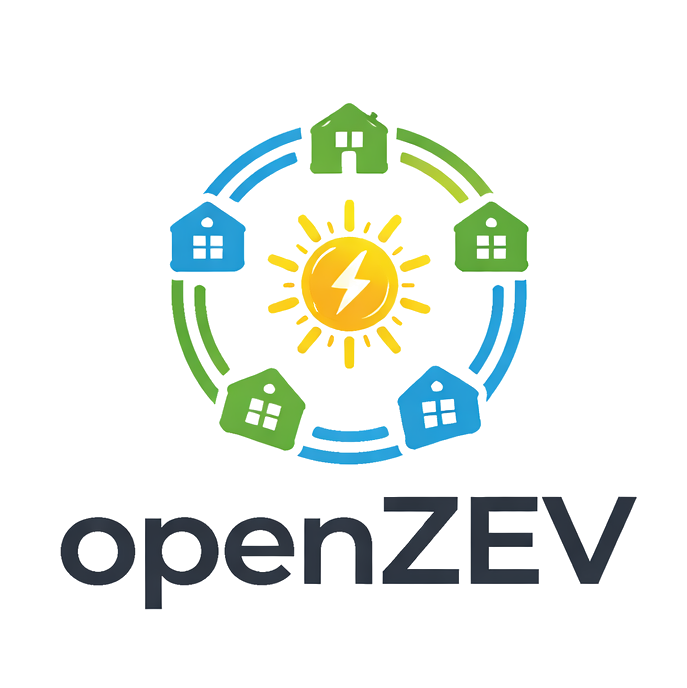
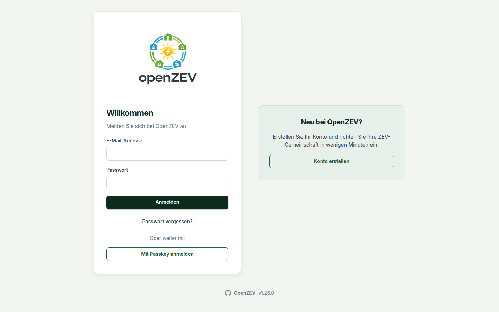
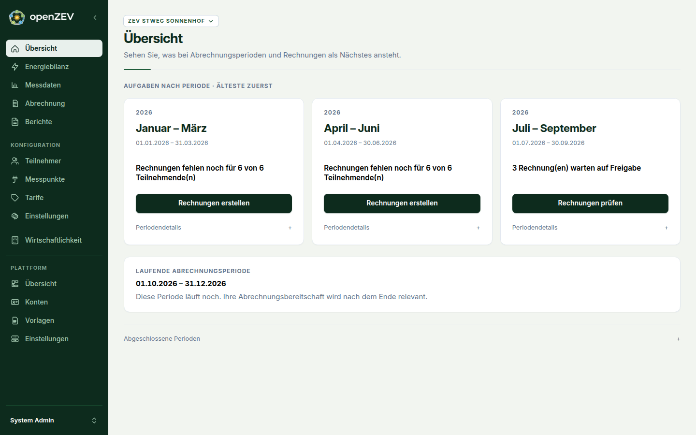
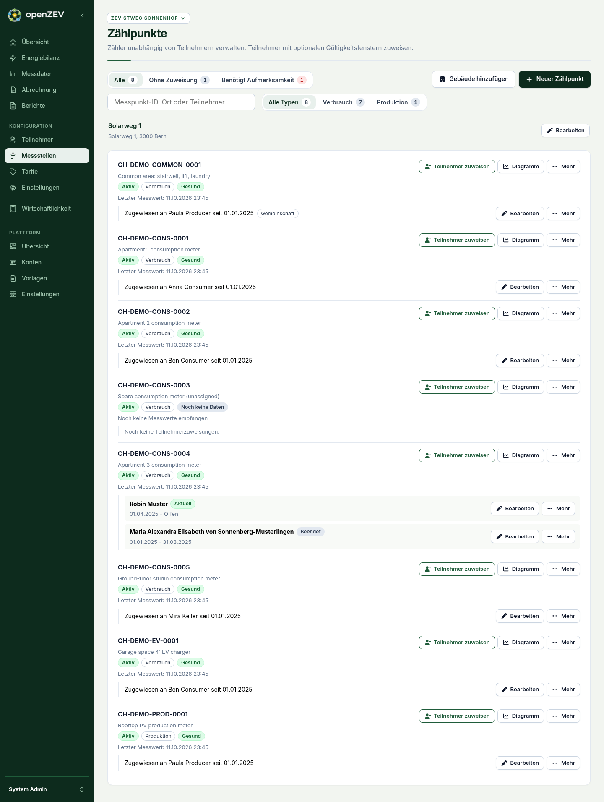
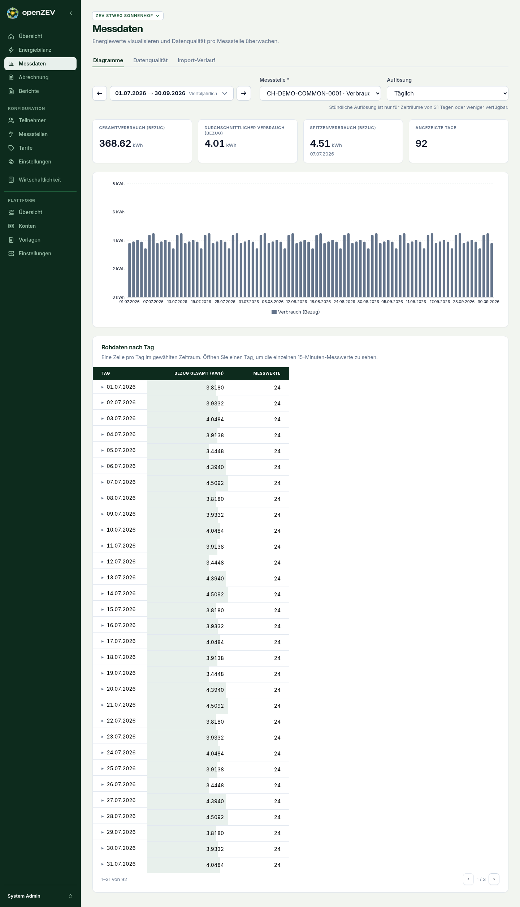
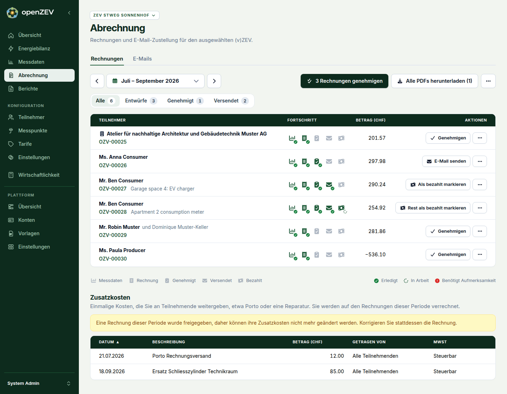
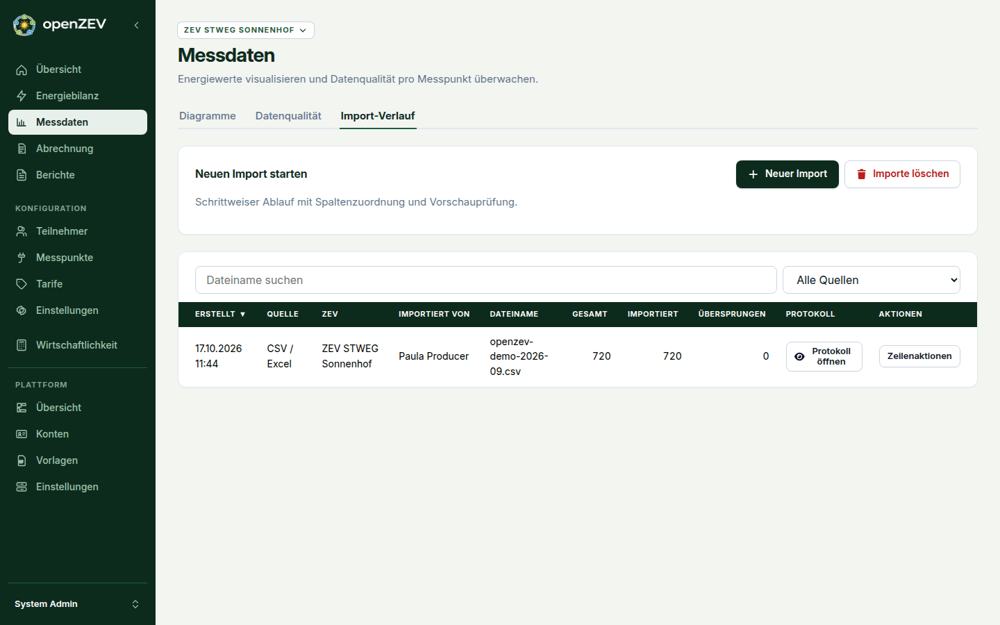

# OpenZEV

[](https://github.com/splattner/openzev/releases)
[](https://github.com/splattner/openzev/actions/workflows/container-build.yml)
[](LICENCE.md)

Open source billing software for Swiss ZEV and vZEV energy communities.



A ZEV is one grid connection shared by several households, which means somebody has
to work out who owed what for the solar. OpenZEV does that end to end: import the
meter load curves, split each 15-minute interval between participants, price it
against your tariffs, and produce a PDF invoice with a QR-bill payment slip.

I wrote it to bill my own ZEV, and put it out in case it is useful for yours.
Self-hosted, AGPL-3.0.

## Disclaimer

- Built for personal use and self-hosting tinkerers who enjoy running their own stack.
- Shipped as-is, with no warranty (yes, even when it looks great in the dashboard).
- Check your data and billing outputs before they reach a participant. I can't take responsibility for incorrect imports, calculations, invoices, or invoicing workflows.
- Built with generous AI assistance, right down to the specs, ADRs, and user docs. Some choices may therefore look a little unconventional, or fall short of what a more experienced team would do today. That is not accidental: the project is optimized for learning, experimentation, and running my own ZEV, not for enterprise-grade process perfection.

## What it does

### Communities, roles and metering points

Access is per ZEV. Managers run a ZEV: whoever holds its issuer or representative
role, plus anyone granted manager access. Viewers see the same screens read-only,
and participants get self-service access to their own consumption and invoices.
Admins see every ZEV. One account can relate to several ZEVs in different ways and
switch between them.

Assignments between participants and metering points carry validity dates, so
someone who moves out on 15 March is billed to 15 March and the next tenant picks up
from there. Billing interval, invoice language and email templates are set per ZEV.

### Metering imports

- CSV and Excel with configurable column mapping, in two format profiles: point readings, and daily 15-minute curves
- SDAT-CH, for when your utility speaks it
- Every import runs as a preview first and writes a per-row protocol, so you see what a file will do before it does it
- A data-quality view flags gaps, duplicates and implausible readings per meter
- Consumption and production as charts by period, or as a daily profile

### Tariffs and billing

Allocation runs per timestamp: for each 15-minute interval the local pool is split
across participants and priced with the tariff version that was valid at that moment.
Tariffs are versioned series with high/low bands, seasonal periods and validity
windows, so an invoice raised last year still prices at last year's rate.

Dynamic price series work the same way, including the BFE reference market price, and
a grid operator's machine-readable tariff file (Art. 7b StromVV) can be imported
directly instead of typed in.

Invoices move through draft → approved → sent → paid, with cancelled branching off
any stage. Cancelling keeps the document and its number rather than deleting the row.

### Documents

Invoices render as PDF/A-3b with a Swiss QR-bill payment slip. Annual statements and
participation contracts come out of the same renderer, and every issued version is
kept exactly as it was sent.

### Feasibility planning

Estimates savings, payback, ROI and NPV for a community you have not founded yet,
modelling individual producers and consumers with a per-participant benefit split and
an energy-flow diagram. If you already run a ZEV, it can prefill from its
participants, measured self-consumption and all-in tariffs.

### Invoice email

Invoice emails go out asynchronously through Celery, with per-invoice delivery
history and a retry for failed sends. Templates are per ZEV, with defaults that work
without editing.

### Odds and ends

- Frontend in German, French, Italian and English
- API keys for scripting, with an optional read-only scope and their own rate budget
- An audit log over privileged actions, scoped to what the viewer is allowed to see
- Export or move a whole community between instances as a versioned archive
- OpenAPI schema with Swagger UI and ReDoc

## Screenshots

### Login



### Dashboard



Overview of KPIs, invoice status, and operational health.

### Metering Points



### Metering Data



### Invoices



Invoice lifecycle management, PDF generation, and email tracking.

### Metering Import Wizard



Step-by-step import flow with mapping, preview, and validation feedback.

## Stack

- Backend: Django, Django REST Framework, SimpleJWT
- Frontend: React, TypeScript, Vite, React Query, i18next
- Async jobs and schedules: Celery worker + Beat with Redis broker
- Database: SQLite (default), PostgreSQL, MariaDB via `DATABASE_URL`
- Deploy: Docker Compose, or the Helm chart on Kubernetes

## User Documentation

All end-user documentation lives in `docs/user-guide/`, organized by workflow, and is published at <https://www.openzev.ch/docs/>.

- User guide index: [docs/user-guide/README.md](docs/user-guide/README.md)
- Energy allocation and billing details: [docs/user-guide/08-billing-allocation-explained.md](docs/user-guide/08-billing-allocation-explained.md)
- vZEV feasibility calculator: [docs/user-guide/13-feasibility-calculator.md](docs/user-guide/13-feasibility-calculator.md)

## Security

Report vulnerabilities privately (see [SECURITY.md](SECURITY.md)).

## Quick Start (Docker)

### Local development and demo

Start the full stack and seed a reusable demo environment in one command:

```bash
scripts/start-demo-environment.sh
```

The script creates `backend/.env` from `backend/.env.example` (development
defaults, `DEBUG=True`) when it does not exist yet, then starts the default
stack and runs `seed_demo`. It refuses to run when `backend/.env` disables
`DEBUG` (a production configuration) instead of seeding it. For day-to-day frontend/backend development with
live reload instead, use the dev stack:

```bash
docker compose -f docker-compose.dev.yml up -d --build
```

Stop it with:

```bash
docker compose -f docker-compose.dev.yml down
```

Services: Frontend <http://localhost:8080> · Backend API <http://localhost:8080/api/v1/> · PostgreSQL and Redis internal to the compose network.

> **Breaking local API endpoint change:** the default API is now `http://localhost:8080/api/v1/` via nginx (the backend port is no longer published). `docker-compose.dev.yml` still serves it directly on port 8001.

### Self-hosting

Every release ships a `docker-compose.yml` that runs the published
[images](#prebuilt-container-images) — no checkout or build needed. Download it
and the production template from the
[latest release](https://github.com/splattner/openzev/releases/latest), then
configure the template for this host (leave `CORS_ALLOWED_ORIGINS` empty for
same-origin deployments where nginx proxies `/api/`):

```bash
cp env.production.example .env
```

Then start without demo data:

```bash
docker compose up -d
```

The instance starts without any accounts. Create the first admin (you sign in
with its email address):

```bash
docker compose exec app python manage.py createsuperuser
```

The stack requires `.env` before starting. Only the application (`8080`) is
reachable from the host; gunicorn is not published and is reachable only through
the bundled nginx's `/api/` proxy, while PostgreSQL and Redis talk over the
compose network only. To update, download the new release's `docker-compose.yml`
and run `docker compose pull && docker compose up -d`. To build from source
instead, see [Building from source](#building-from-source-with-compose).

Configure the SMTP settings and sender address in `.env` before using
registration, onboarding, invoice, or security emails; see the [Email
Configuration guide](docs/user-guide/10-email-configuration.md).

> **HTTPS is required for public access.** With `DEBUG=False` the auth and
> CSRF cookies are `Secure`, so browsers only send them over HTTPS — plain
> HTTP works for local loopback testing, but a public domain needs TLS
> termination (e.g. a reverse proxy in front of port `8080`). Set
> `ALLOWED_HOSTS` to the public hostname, `CSRF_TRUSTED_ORIGINS` and
> `FRONTEND_URL` to the public `https://` origin (even when
> `CORS_ALLOWED_ORIGINS` stays empty for same-origin deployments), and open
> the app at that `https://` URL.

The shipped nginx sanitizes `X-Forwarded-For` and the production stack keeps
`NUM_PROXIES=1`. If another proxy sits in front of it, audit and rate-limit
identity is therefore the immediate outer-proxy address; do not increase
`NUM_PROXIES` unless the entire proxy chain is deliberately sanitized and
configured to preserve client addresses.

> **`/media/` is never web-served in production** — invoice files are served
> only through authenticated API endpoints.

Services: Frontend <http://localhost:8080> · Backend API <http://localhost:8080/api/v1/> (via nginx).

> **Upgrading from a stack started before this change:** the Postgres data
> directory is now pinned to `PGDATA=/var/lib/postgresql/data/pgdata` inside the
> `postgres_data` volume, and all three compose files mount that volume at the
> same path. Previously `docker-compose.yml` and `docker-compose.dev.yml`
> disagreed on the mount path, so the two stacks could not see each other's
> database. An existing volume holds its cluster at the old location, so the
> first start after this change initialises an empty one. Dump anything you want
> to keep first:
>
> ```bash
> docker compose up -d db
> docker compose exec db pg_dump -U openzev openzev > backup.sql
> docker compose down -v          # discards the old volume
> docker compose up -d --build
> docker compose exec -T db psql -U openzev openzev < backup.sql
> ```
>
> For demo data, `scripts/start-demo-environment.sh` reseeds from scratch and no
> dump is needed.

For a step-by-step walkthrough — production setup, the first admin account, roles, exploring each interface, demo accounts, and resetting demo data — see the [Getting Started guide](docs/user-guide/01-getting-started.md).

## Building from source with Compose

To build the production stack from a checkout instead of using the release
images, fill in the production checklist as above (as `backend/.env`), then use
the single application container build:

```bash
cp backend/.env.production.example backend/.env
docker compose -f docker-compose.fullstack.yml up -d --build
```

`app` serves the frontend and proxies API requests to Django inside the same container; `worker`, `db`, and `redis` stay separate. Frontend URL: <http://localhost:8080>. Stop with `docker compose -f docker-compose.fullstack.yml down`.

See the [Getting Started guide](docs/user-guide/01-getting-started.md#building-from-source) for details.

## Helm Installation (Kubernetes)

OpenZEV ships as a Helm chart in [`charts/openzev`](charts/openzev/README.md).

The chart deploys the frontend, backend, a Celery worker, and one Celery Beat
scheduler, plus an Ingress and a PVC for `/app/media`. It does **not** deploy
PostgreSQL or Redis — you must provide reachable external database and Redis
endpoints.

```bash
helm repo add openzev https://splattner.github.io/openzev
helm repo update
helm install openzev openzev/openzev -n openzev --create-namespace
```

For install options and example values (external DB/Redis secrets, email, ingress), see the [Helm chart README](charts/openzev/README.md).

## Prebuilt Container Images

Prebuilt images are published to GitHub Container Registry (GHCR), the current image names are:

- `ghcr.io/splattner/openzev-backend`
- `ghcr.io/splattner/openzev-frontend`
- `ghcr.io/splattner/openzev-fullstack`

Available image variants:

- `openzev-backend`: Django API application
- `openzev-frontend`: static frontend served with Nginx
- `openzev-fullstack`: frontend assets + backend in one container for simpler test deployments

Available tags:

- Release tags such as `v1.2.3`
- `latest` for the newest published release
- `main` for the newest build from the `main` branch
- `main-<short-sha>` for a specific `main` branch commit build

### Stability Note for `main` Images

Images tagged `main` are intended for testing and preview deployments before a formal release.

- They are rebuilt on every commit pushed to `main`
- They may contain unfinished changes or breaking behavior
- They should be considered unstable and not be treated like a versioned release artifact

If you need reproducible deployments, prefer a release tag such as `v1.2.3` instead of `main`.

### SBOMs and Signatures

- Release images are published with signed container manifests and signed SBOM attestations
- `main` branch images are also pushed, signed, and accompanied by generated SBOMs
- Release SBOM files are attached to the GitHub release
- `main` branch SBOM files are uploaded as workflow artifacts in the `Container Build Check` workflow run
- SBOM verification is performed through the signed attestation bound to the image, not through a separate detached signature on the raw `.spdx.json` file

### Verify an Image Signature

Install `cosign` locally, then verify an image with GitHub OIDC keyless signatures:

```bash
cosign verify \
  --certificate-identity-regexp "https://github.com/splattner/openzev/.github/workflows/.*" \
  --certificate-oidc-issuer "https://token.actions.githubusercontent.com" \
  ghcr.io/splattner/openzev-backend:main
```

For a release image, replace the tag with the release version, for example `:v1.2.3`.

### Verify the SBOM Attestation

You can verify the signed SBOM attestation attached to an image:

```bash
cosign verify-attestation \
  --certificate-identity-regexp "https://github.com/splattner/openzev/.github/workflows/.*" \
  --certificate-oidc-issuer "https://token.actions.githubusercontent.com" \
  --type spdxjson \
  ghcr.io/splattner/openzev-backend:main
```

To inspect the attested predicate after verification, add `| jq '.payload | @base64d | fromjson'` or download the generated `.spdx.json` artifact directly from the workflow or release.

## Local Development Setup

### 1) Backend

```bash
cd backend
cp .env.example .env
python -m venv ../.venv
source ../.venv/bin/activate
pip install -r requirements.txt
python manage.py migrate
python manage.py runserver
```

Optional admin user:

```bash
python manage.py createsuperuser
```

### 2) Frontend

Use the Node version pinned in `.node-version`.

```bash
cd frontend
cp .env.example .env
npm install
npm run dev
```

Frontend dev URL: <http://localhost:5173>

For `docker-compose.dev.yml` with non-default frontend ports, export `CORS_ALLOWED_ORIGINS` with your frontend origin before starting the stack. `CSRF_TRUSTED_ORIGINS` follows it unless explicitly overridden.

> Cookie sessions require same-origin (or same-host reverse proxy, e.g. `VITE_API_BASE_URL=/api/v1`). Same-host different-port dev (`localhost:5173` → `localhost:8001`) works with `CORS_ALLOWED_ORIGINS`/`CSRF_TRUSTED_ORIGINS`. Truly cross-hostname (`app.example.com` → `api.example.com`) cannot be fixed by those settings alone — JS cannot read a cross-origin `csrftoken` cookie — use a same-origin reverse proxy.

### 3) Celery worker and Beat scheduler

```bash
cd backend
source ../.venv/bin/activate
celery -A config worker -l info
# In a second terminal; run exactly one scheduler per deployment.
celery -A config beat -l info --scheduler django_celery_beat.schedulers:DatabaseScheduler
```

## Seed Data & Demo Accounts

Use seeded data for quick local testing of flows.

```bash
cd backend
source ../.venv/bin/activate
python manage.py seed_demo
```

By default, `--end-date` is today and `--start-date` is the start of the
complete quarter before that end date. Both dates accept `YYYY-MM-DD`; use
`--end-date` to reproduce a historical window and `--start-date` to override
its default start.

Seeded demo users:

- Admin: `admin@openzev.local` / `admin1234`
- Issuer and manager: `owner@openzev.local` / `owner1234`
- Participant (ZEV 1): `anna@openzev.local` / `anna1234`
- Participant (ZEV 1, flat 2 + parking space with charger): `ben@openzev.local` / `ben1234`
- Participant (ZEV 2): `clara@openzev.local` / `clara1234`
- Viewer (ZEV 1, read-only): `viewer@openzev.local` / `viewer1234`
- Property manager (both ZEVs): `manager@openzev.local` / `manager1234`
- Former participant (ZEV 1, moved out): `former@openzev.local` / `former1234`
- Joint household (ZEV 1): `household@openzev.local` / `household1234`
- Organisation participant (ZEV 1): `organisation@openzev.local` / `organisation1234`
- Manager of ZEV 1 by grant + participant of ZEV 2: `mixed@openzev.local` / `mixed1234`
- Viewer of ZEV 1 until 31 March next year (Treuhand): `treuhand@openzev.local` / `treuhand1234`
- No ZEV yet, may set one up: `newcomer@openzev.local` / `newcomer1234`
- Pending invitation (ZEV 2 viewer, no password yet): `invitee@openzev.local`

"Last year" below means the year before `--end-date`.

- **Dated issuer:** Otto Vorbesitzer (no login) issued the flagship's invoices until
  30 June last year, Paula Producer from 1 July.
- **Tenant change:** Maria left flat 3 after Q1 last year and the Musters took over the
  same meter. Maria's login shows only her one invoice; she has moved away since, and
  that invoice keeps her old address.
- **Parties that are not participants:** the Verwaltung Muster AG represents the
  flagship and manages it through that role; Hans Hauswart is a contact without access.
- **Landowners:** each house of the second ZEV has its own (Paula, Clara, Lukas). The
  role grants no access.

The seed command creates two communities owned by the same demo owner, so the community switcher can be exercised:

- **ZEV STWEG Sonnenhof** — the flagship, a single-building condominium (`zev`) with quarterly billing, German invoices and VAT folded into its prices. Carries participants, metering points, tariffs and hourly readings from 1 January of the previous year through the seed window, with 15-minute readings only for its latest 14 days. The previous year is billed quarter by quarter as paid invoices, except when its final quarter overlaps the open prior quarter; that prior quarter has draft, approved and sent invoices.
- **ZEV Sonnenfirma AG** — a smaller property-company (`vzev`) with monthly billing, English invoices, VAT-registered with a UID, shared grid-connection and per-metering-point fees, and itemized tariff bands. Carries its own participants, metering points, tariffs and readings, plus two invoice periods: the prior complete month in draft/approved/sent and the month before it closed (paid/cancelled).

The standard Swiss VAT ranges (7.7 % from 2018 and 8.1 % from 2024) are added only when no existing rate overlaps each range; existing VAT timelines are preserved. The operational/log pages are seeded too — metering import logs (CSV + SDAT-CH, with CSV provenance on a real meter month), invoice email logs, two issued contract snapshots (Anna and Clara), stored PDFs for Anna's sent and paid invoices, and audit events (including one denied) — and one meter on the flagship carries an intentional ~12-day reading gap in the current quarter so the data-quality page has a real issue to show.

The flagship also carries **Netznutzung dynamisch**, linked to a synthetic price
source with quarter-hourly prices from the start of the quarter containing
`--end-date` through the following day. The tariff starts after all seeded
invoice periods, so their totals are unchanged. Fetching is disabled and the
source URL is a reserved `.invalid` host, so seeding never calls a tariff API.
Re-seeding keeps the stored prices.

Re-running `seed_demo` refreshes the demo readings, invoices and Anna's PDFs, import/email logs and audit events, while retaining contract snapshots. If the seed transaction rolls back, existing invoice rows and PDFs remain unchanged. PDF generation and cleanup run after commit and are best-effort. Screenshot captures explicitly select ZEV STWEG Sonnenhof so they consistently show the same community.

## API & Developer Docs

- Swagger UI: <http://localhost:8080/api/docs/>
- ReDoc: <http://localhost:8080/api/redoc/>
- Base API prefix: `/api/v1/`

Development stack (`docker-compose.dev.yml`) serves these directly on port 8001.

## Development Notes

- Without Docker, the backend defaults to SQLite (see `backend/.env.example`). Docker Compose uses PostgreSQL. MariaDB is also supported.
- Async tasks (invoice emails, PDF generation, geocoding) require Redis and a
  Celery worker. Periodic work such as dynamic-tariff refreshes also requires
  exactly one Celery Beat scheduler. Docker Compose includes all three; for
  other setups, ensure they are running.
- Use `.env.example` as baseline for environment configuration.
- Keep migrations up to date when changing models:

```bash
cd backend
source ../.venv/bin/activate
python manage.py makemigrations
python manage.py migrate
```

- Run backend tests from repository root:

```bash
pytest
```

- Build frontend before release:

```bash
cd frontend
npm run build
```

## Development Process: Specs and ADRs

OpenZEV uses **feature specifications** and **architecture decision records**
(ADRs) to document and communicate larger changes. Both are linked from pull
requests when a change is significant or cross-cutting.

- **Specifications** (`docs/specs/`) — required for changes to API behavior,
  billing/tariff logic, invoice workflow, data models/migrations, async jobs, or
  security/role/ZEV-scope. Full process and the baseline-spec index:
  [`docs/specs/README.md`](docs/specs/README.md).
- **ADRs** (`docs/adr/`) — record high-impact architecture decisions with
  long-term consequences. Full process and the index:
  [`docs/adr/README.md`](docs/adr/README.md).
- **Agent guidance** — coding agents should follow the working agreements and
  spec-maintenance rules in [`AGENTS.md`](AGENTS.md).

For pull requests, link affected specs/ADRs using
`.github/PULL_REQUEST_TEMPLATE.md`.

## Release Workflow (GitHub)

Releases are automated via GitHub Actions (see `.github/workflows/`):

- PR titles must follow Conventional Commits; Release Please manages SemVer tagging and changelog generation.
- Pull requests run lint/check/test and container build checks without pushing images.
- Commits to `main` build, push, sign, and SBOM-attach preview images (tags `main`, `main-<sha>`).
- Published releases build and push versioned images to GHCR (see [Prebuilt Container Images](#prebuilt-container-images)).
- Renovate keeps npm/pip/GitHub Action dependencies up to date.
