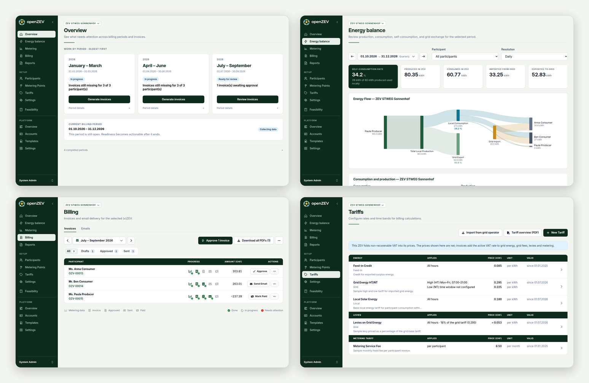

# OpenZEV

[](https://github.com/splattner/openzev/releases)
[](https://github.com/splattner/openzev/actions/workflows/container-build.yml)
[](LICENCE.md)

**Open-source billing software for Swiss ZEV and vZEV energy communities.**



A ZEV shares a single grid connection across multiple households, meaning someone has to calculate each household's share of solar and grid power. OpenZEV covers the whole billing process:

1. **Import** meter load curves (CSV, Excel, SDAT-CH).
2. **Allocate** every 15-minute interval across participants.
3. **Price** consumption against versioned or dynamic tariffs.
4. **Invoice** participants with PDF/A-3b statements and Swiss QR-bills.

I built OpenZEV to bill my own ZEV and published it under AGPL-3.0 in case it is useful for yours.

## Features

- **Communities and roles:** Per-ZEV access for managers, viewers, and participants, with dated participant-to-meter assignments for tenant changes.
- **Metering import:** CSV, Excel, and SDAT-CH support with a pre-write preview and a data-quality view for gaps and duplicates.
- **Billing engine:** 15-minute interval allocation, versioned tariffs (high/low bands, seasons), dynamic pricing, and grid-operator tariff imports.
- **Invoices and contracts:** Full workflow (`draft` → `approved` → `sent` → `paid`) generating PDF/A-3b invoices with Swiss QR-bills, annual statements, and participation contracts.
- **Email delivery:** Background email sending with per-invoice delivery history and automatic retries.
- **Feasibility calculator:** Estimate savings, payback, and ROI before founding a community.
- **Administration and integrations:** Multi-language UI (DE, FR, IT, EN), API keys, audit log, whole-ZEV export/import, backups, and an MCP server for AI assistants.

See the [user guide](https://www.openzev.ch/docs/) for details, and the [roadmap](docs/ROADMAP.md) for what is shipped and planned.

## Quick start

### Try the demo

Requires Docker or Podman with Compose:

```bash
git clone https://github.com/splattner/openzev.git
cd openzev
scripts/start-demo-environment.sh
```

Open <http://localhost:8080> and sign in with `admin@openzev.local` / `admin1234`.

> [!WARNING]
> The demo environment runs with `DEBUG=True` and well-known credentials. Never use it for real billing data.

### Run in production

Every release includes a ready-made `docker-compose.yml` for the published container images, and a Helm chart is available in [`charts/openzev`](charts/openzev/README.md) for Kubernetes.

Follow the [Getting Started guide](docs/user-guide/01-getting-started.md) to configure HTTPS, email delivery, your initial admin account, backups, and updates.

## Documentation

- **User guide:** [openzev.ch/docs](https://www.openzev.ch/docs/) (sources in [`docs/user-guide/`](docs/user-guide/README.md)) — setup, imports, tariffs, billing, and administration.
- **Releases:** [Roadmap](docs/ROADMAP.md) and [release notes](https://github.com/splattner/openzev/releases).
- **API reference:** Swagger UI at `/api/docs/` and ReDoc at `/api/redoc/` on a running instance.
- **Architecture:** [Specs](docs/specs/README.md) and [architecture decision records (ADRs)](docs/adr/README.md).

## Tech stack

- **Backend:** Django, Django REST Framework, SimpleJWT.
- **Frontend:** React, TypeScript, Vite, TanStack Query, i18next.
- **Async jobs:** Celery worker and Beat with Valkey (Redis-compatible).
- **Database:** PostgreSQL for production; SQLite for local development/tests *(MariaDB is not supported due to metering correction and identity-lock workflows)*.
- **Deployment:** Docker Compose or Kubernetes (Helm); GHCR images are signed and include an SBOM.

## Disclaimer

- Shipped as-is with no warranty.
- Always verify your data and billing outputs before sending them to participants. I cannot take responsibility for incorrect imports, calculations, invoices, or workflows.
- Built with generous AI assistance—including specs, ADRs, and user docs. Some design choices may look unconventional; the project is optimized for learning, experimentation, and running my own ZEV rather than enterprise-grade polish.

## Contributing & security

- **Contributing:** Issues and pull requests are welcome. See [CONTRIBUTING.md](CONTRIBUTING.md) for development setup, CI checks, and the spec-driven process for larger changes.
- **Security:** Please report vulnerabilities privately as described in [SECURITY.md](SECURITY.md).

## Licence

[AGPL-3.0](LICENCE.md)
