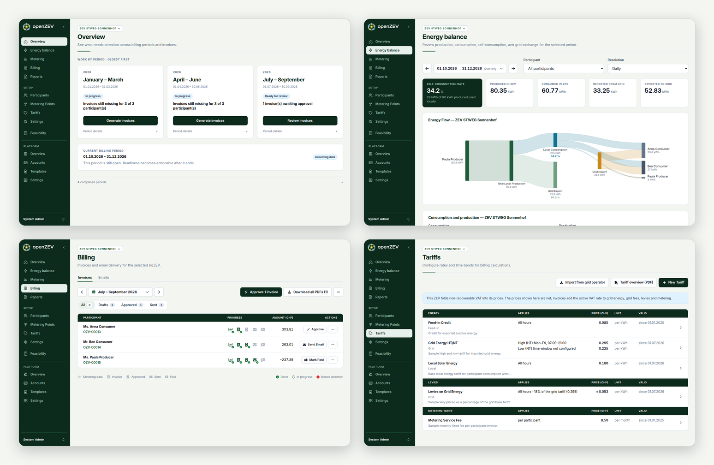

# OpenZEV

[](https://github.com/splattner/openzev/releases)
[](https://github.com/splattner/openzev/actions/workflows/container-build.yml)
[](LICENCE.md)

Open source billing software for Swiss ZEV and vZEV energy communities.



A ZEV is one grid connection shared by several households, which means somebody has
to work out who owed what for the solar. OpenZEV does that end to end: import the
meter load curves, split each 15-minute interval between participants, price it
against your tariffs, and produce a PDF invoice with a QR-bill payment slip.

I wrote it to bill my own ZEV, and put it out in case it is useful for yours.
Self-hosted, AGPL-3.0.

## Disclaimer

- Built for personal use and self-hosting tinkerers who enjoy running their own stack.
- Shipped as-is, with no warranty (yes, even when it looks great in the dashboard).
- Check your data and billing outputs before they reach a participant. I can't take responsibility for incorrect imports, calculations, invoices, or invoicing workflows.
- Built with generous AI assistance, right down to the specs, ADRs, and user docs. Some choices may therefore look a little unconventional, or fall short of what a more experienced team would do today. That is not accidental: the project is optimized for learning, experimentation, and running my own ZEV, not for enterprise-grade process perfection.

## Features

- **Communities and roles:** access per ZEV for managers, viewers and participants, with dated participant-to-meter assignments for tenant changes
- **Metering import:** CSV, Excel and SDAT-CH, with a preview before anything is written and a data-quality view for gaps and duplicates
- **Billing engine:** allocation per 15-minute interval, versioned tariffs with high/low bands and seasons, dynamic prices, and tariff import from your grid operator
- **Invoices:** draft → approved → sent → paid, as PDF/A-3b with a Swiss QR-bill, plus annual statements and participation contracts
- **Email delivery:** asynchronous, with per-invoice history and retry
- **Feasibility calculator:** savings, payback and ROI for a community you have not founded yet
- **Also:** German, French, Italian and English UI, API keys, audit log, whole-ZEV export/import, backups, and an MCP server for AI assistants

See the [user guide](https://www.openzev.ch/docs/) for the details, and the [roadmap](docs/ROADMAP.md) for what is shipped and what is next.

## Quick start

Try it with demo data (needs Docker or Podman with Compose):

```bash
git clone https://github.com/splattner/openzev.git
cd openzev
scripts/start-demo-environment.sh
```

Then open <http://localhost:8080> and sign in as `admin@openzev.local` / `admin1234`.
The demo runs with `DEBUG=True` and well-known passwords, so never use it for real data.

To run OpenZEV for your own community, every release ships a ready-made
`docker-compose.yml` for the published images, and there is a Helm chart in
[`charts/openzev`](charts/openzev/README.md) for Kubernetes. The
[Getting Started guide](docs/user-guide/01-getting-started.md) covers both, plus
HTTPS, email, the first admin account, backups and updates.

## Documentation

- [User guide](https://www.openzev.ch/docs/) (sources in [`docs/user-guide/`](docs/user-guide/README.md)): setup, imports, tariffs, billing and administration
- [Roadmap](docs/ROADMAP.md) and [release notes](https://github.com/splattner/openzev/releases)
- API reference: Swagger UI at `/api/docs/` and ReDoc at `/api/redoc/` on a running instance
- [Specs](docs/specs/README.md) and [architecture decisions](docs/adr/README.md)

## Tech stack

- Backend: Django, Django REST Framework, SimpleJWT
- Frontend: React, TypeScript, Vite, TanStack Query, i18next
- Async jobs: Celery worker and Beat with a Valkey broker (Redis-compatible)
- Database: PostgreSQL, or SQLite and MariaDB via `DATABASE_URL`
- Deployment: Docker Compose, or the Helm chart on Kubernetes. Images are published to GHCR, signed, with an SBOM.

## Contributing

Issues and pull requests are welcome. [CONTRIBUTING.md](CONTRIBUTING.md) covers the
development setup, the checks CI runs, and the spec-driven process for larger changes.

## Security

Please report vulnerabilities privately, as described in [SECURITY.md](SECURITY.md).

## Licence

[AGPL-3.0](LICENCE.md)
