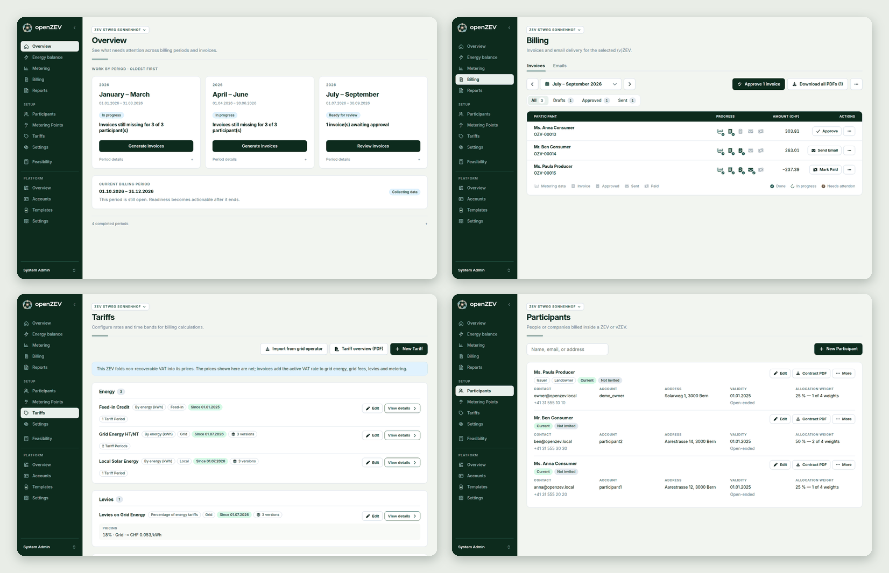

This release gives the app the look of the PDFs, ships a ready-made Compose file
for self-hosting, and adds a retention sweep for personal data. If your ZEV is
VAT-registered and pays a producer, read **Fixes worth knowing about** first.

### A new look

The app now speaks the same visual language as your invoices and statements.
The annual statement and the tax overview move onto the shared PDF layout, and
every PDF is now set in Inter, so invoices sent to participants look different.
A customised PDF template is flagged as outdated.

The redesign is a large contribution (about 160 files) from **@spalinger**, who
also fixed two of the bugs below and the feature-flag switch. Thank you!

Some things were simplified rather than restyled:

- **Community switcher.** It left the sidebar: pages that depend on the
  community let you pick it above the title; platform, account and detail
  pages have none.
- **Lists.** Tables show 100 rows per page; the rows-per-page choice is gone.
  Filter tabs that would not change the list are hidden. Participants lose
  **Ready** and gain **No metering point**; metering points lose **Assigned**.
  The tariff summary chips are gone.
- **Tariff overview PDF.** Its scope is chosen from a menu at download and no
  longer follows the list filter.

### Run the release images

Every release now carries a `docker-compose.yml` and an `env.production.example`
as downloads, so a production install needs no checkout and no build. Download
both into an empty directory, copy the template to `.env`, fill it in and run
`docker compose up -d`. The stack runs the published, signed
`openzev-fullstack` image as `app`, `worker` and `beat`, plus PostgreSQL and
Redis. The file pins the version it was released with; set `OPENZEV_VERSION` in
`.env` to override it, and update with `docker compose pull && docker compose
up -d`. The service is called `app` (`backend` in the source-build stacks).

The getting-started guide gained a Synology Container Manager walkthrough and
Caddy and Traefik examples for the HTTPS step. Installs built from a checkout
and the Helm chart are unchanged; there is no two-container release stack.

### Retention for personal data

A daily job now removes personal data that never expired:

- the IP address and user agent on audit events after 365 days (the event stays),
- the recipient and error text of invoice emails after 730 days (the row stays,
  because it feeds the "delivery failed" item on open invoices),
- spent, revoked or expired verification, magic-link and onboarding tokens 30
  days after they stopped working. Live tokens are never touched.

`manage.py openzev_privacy_sweep --dry-run` shows what would go. Blanking cannot
be undone, and a failed invoice email whose recipient was blanked cannot be
retried: send the invoice again. Addresses inside free-form audit summaries and
custom email subjects are not covered. The windows are set in Upgrading below.

### Energy data starts on "My metering points"

Connecting your own energy data (1.22) took four steps in four places. A
participant now finds it all under **My metering points** in the sidebar: each
meter they hold is a card, and those flagged **Generation behind the meter**
carry the connect, status and sync controls. The **Energy data** tab under
**Account** is gone. Managers who hold a flagged meter get the page for their
own meters, and a flagged meter with no source shows **No energy data source**
in the manager's list.

The platform flag `supplementary_energy_data_enabled` (**Platform → Settings →
Functions**) is now on as soon as `INTEGRATION_ENCRYPTION_KEYS` is configured,
unless an administrator has chosen a value; an explicit off wins. **If you had
switched it off on purpose and the key is set, it is on again after the
upgrade: switch it off once more.** The migration cannot tell your choice from
the seeded default.

### Also new

- Feature flags use the same switch as the rest of the app.
- Invoice generation is faster; the output is identical.

### Fixes worth knowing about

- **VAT on producer credits (VAT-registered ZEVs).** The credit paid to a
  producer was subtracted before VAT was charged, so output VAT came out too
  low, and negative for a participant who only produces. VAT is now charged on
  what the ZEV supplies, and the credit is settled afterwards: fee 100.00, VAT
  8.10, credit −40.00 now totals 68.10 instead of 64.86. Issued invoices keep
  their stored VAT, so check any you sent for a producer you pay. A custom
  invoice template keeps printing the old rows; the admin-console chapter has
  the snippet. The feed-in credit is still taken off the base (#969).
- **Stuck in impersonation.** After an hour, **Stop** answered "No active
  impersonation session" and the participant view stayed, even after a reload.
  It now restores the admin, or sends you to the login page if that session is
  gone.
- **Meter health.** The check ran up to today, but today's readings arrive with
  the next import, so every meter showed a one-day gap and counted as needing
  attention. It now covers the last 30 complete days, as does the assistant's
  `data_gaps` tool.

### Under the hood

ADR 0032 records the shared visual language (*Proposed* until the colour and
typography choices are settled), ADR 0033 why the energy data flag follows the
key.

### Upgrading

Two additive migrations, no downtime: `invoices` 0020 adds a nullable
`vat_base_chf`, and `accounts` 0023 adds `follows_default` to feature flags and
marks a stored "off" energy data flag as unchosen (see above).

**Configuration.** Optional: `PRIVACY_AUDIT_NETWORK_RETENTION_DAYS` (365),
`PRIVACY_EMAIL_LOG_RETENTION_DAYS` (730) and `PRIVACY_TOKEN_GRACE_DAYS` (30).
`0` keeps that data.

**Deployment.** The backend images now install `fonts-inter` (about 21 MB);
both Dockerfiles fail the build without it, so a self-built image must keep it.

**Changes to watch:**

- The metering point list reads one `view` URL parameter instead of `status`,
  `assignment` and `attention`; an old bookmark opens **All**.
- `/account?tab=energy-data` opens **Profile**.
- The invoice API gains a nullable `vat_base_chf`, null for invoices issued before.
- Retrying an invoice email whose recipient was blanked answers `400`, and
  ending an impersonation can answer `400` with `impersonation_session_expired`.

<!-- release-notes-state
version: 1.23.0
source-pr: 948
triaged:
  951: section   # UI redesign by spalinger; ADR 0032; fonts-inter; list/switcher changes
  970: section   # release compose file; not merged yet, written as if it were (see not-final)
  952: section   # privacy retention sweep; PRIVACY_* settings
  964: section   # energy data on My metering points; flag follows key; migration accounts 0023
  962: fix       # producer credits out of the VAT base; migration invoices 0020
  966: fix       # impersonation stuck; contributed by spalinger
  947: fix       # meter health window; contributed by spalinger
  946: also-new  # feature flag switch; contributed by spalinger
  950: also-new  # faster invoice generation and seed
not-final:
  970: open      # written as if merged, at the maintainer's request. The release PR (948) does not
                 # list it yet; if it is not merged before the cut, delete the "Run the release
                 # images" section and the matching sentence in the opening paragraph. Its
                 # release-images.yml change has not run on a real release yet: check that
                 # docker-compose.yml and env.production.example appear as assets on v1.23.0.
  955: open      # renovate python 3.15; omit when it lands
  478: open      # renovate frontend major bump; omit when it lands
  416: open      # renovate backend bump; omit when it lands
-->
