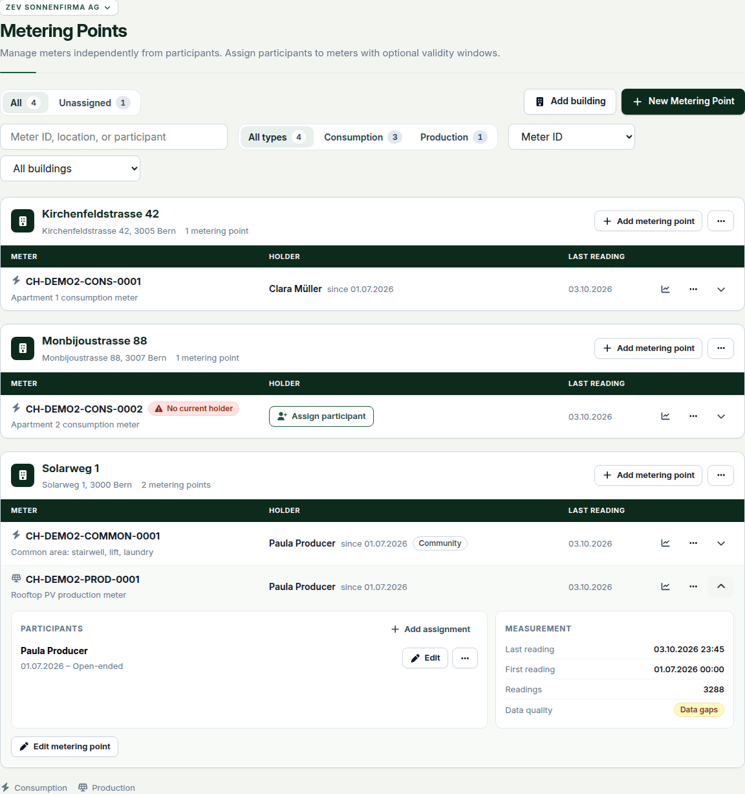
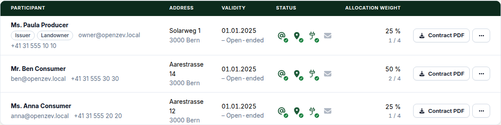
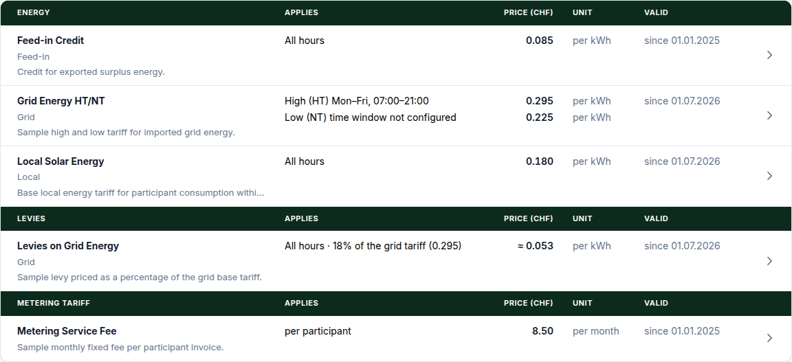

This release closes a hole in participant sign-in links and moves the Metering Points, Participants and Tariffs pages onto the table layout the rest of the app already uses. Apply it promptly if one person manages a community and is also a participant in another.

### Participant links no longer sign in managers or admins

An account can manage one community and be a participant in another. A participant's onboarding or sign-in link signs in as that account, so whoever held the link could act as the manager, or as an admin, and saving the participant row also copied its email onto the login. Participant links now only sign in accounts that have no independent access.

Independent access means an admin, an account allowed to create a community, or anyone who holds or once held a manager or viewer grant, or an issuer or representative role. For these accounts, copying or sending an onboarding link is refused with a message, and a link already out in the wild no longer works. The protection is permanent: revoking a grant does not hand the account back to participant links. If someone is protected by mistake, they sign in with their normal login.

Granting independent access to a participant-only account ends its participant sessions, API keys and links, and requires a login or a pending invitation first. The upgrade marks existing accounts as protected without signing anyone out.

It does not retire a password or second factor that was set up *through* a participant link before the account was promoted. If you promoted such an account, have its holder choose a new password and use **Reset two-factor** under **More** on its row in **Platform → Accounts → Users**.

### Metering points, participants and tariffs as tables

**Metering points.** Each building is a sheet and each meter a row: meter ID, holder, last reading, chart. Open a row to see its assignments and measurement details in place. The status dots, tinted rows, **Needs attention** tab and "problems first" sort are gone; badges remain only for the unusual (inactive, no current holder, an energy source in trouble). **Assign participant** is the one inline action; everything else is under **⋯**.

**Participants.** The default tab is now **Current & upcoming**; participants whose membership ended appear under **Ended**. A red email or address opens the form, a red metering point opens **Metering Points**. The **Account** section is gone, since participants sign in with their email; the account username remains in the unlink confirmation and under **Platform → Accounts**. The onboarding badge became the **Invitation** icon, which shows the link's state, not whether the participant uses the portal.

**Tariffs.** Each category is a rate card with one row per tariff. A new **Upcoming** tab shows tariffs with a version that starts later, for example next year's grid tariff once imported. A band without a complete time window now reads *time window not configured*, as the Low (NT) band does below; it does not automatically cover the remaining hours.

No data, permissions or API change in any of these.

### Also new

- **Data gaps open in a drawer.** On **Metering → Data Quality**, the Missing Days column shows a count; click it to see the meter, its holder, the gap ranges and **Go to imports**, which keeps your period and filters.
- Table sheets end at their last row, and the invoice progress legend sits below the table instead of inside it.

### Upgrading

Two migrations, no downtime, no configuration changes: `accounts.0024` adds `User.independent_login_required`, and `accounts.0025` sets it for admins, community creators and everyone with a grant or managing role.

**Changes to watch:**

- Onboarding and sign-in links for protected accounts now answer `own_login_required`, or `login_setup_required` for a managing party without an account. Public endpoints answer as for an unknown link.
- A ZEV restore that would give a managing role to an account with no login or pending invitation is refused with `login_setup_required`, and **force** cannot override it. Set up a login or send an access invitation first, then run the dry run again.
- A grant's community and account, and a role's community, party and kind, can no longer be edited in place. Revoke or end it and create a new one.
- Inviting a participant who has no password turns off their participant sign-in until they accept the invitation. If the email fails, use **Resend invitation**.
- The metering point list no longer has a **Needs attention** view and gains a `sort` parameter.

<!-- release-notes-state
version: 1.24.0
source-pr: 979
triaged:
  983: section   # participant links vs independent accounts; ADR 0034; migrations accounts 0024/0025
  978: section   # metering points building sheets; screenshot 1.24.0-metering-points-expanded-row.png
  982: section   # participants table (folded into the tables section); screenshot 1.24.0-participants.png
  977: section   # tariff rate cards, Upcoming tab (folded into the tables section); screenshot 1.24.0-tariffs.png
  981: also-new  # data gaps drawer
  980: also-new  # table sheets end at last row, invoice legend placement
  972: omit      # dependency bump
  987: omit      # test-only, contributors only
not-final:
  985: open      # docs(accounts): correct stale participant account references. Docs only, omit.
  976: open      # CI Pages deploy, omit.
  986: open      # renovate python 3.15, omit when it lands
  955: open      # renovate python 3.15, omit when it lands
  478: open      # renovate frontend major bump, omit when it lands
  416: open      # renovate backend bump, omit when it lands
-->
