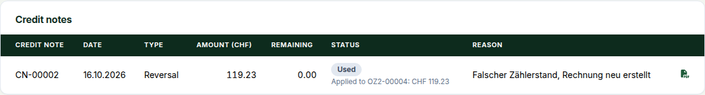

This release lets you record payments and correct an invoice that was already paid, adds password recovery and one account per email address, and hardens the production images. The last two change how you upgrade: the images listen on port 8080 and run as UID 10001, and the account migrations need a short maintenance window. Read **Upgrading** before you pull.

### Payments and credit notes

- **Payments.** On a sent invoice, **Record payment** in the **Payments** card books a partial payment or the date the money arrived; a part-paid invoice shows **Partly paid**. **Mark Paid** on the row still books the whole amount in one click. Invoices already marked paid get one payment for their total.
- **Credit notes.** A paid invoice is corrected, not cancelled: **Correct invoice** in its **Credit notes** card offers **Reverse the invoice** (credits what was received, cancels it, and you generate the period again) or **Credit part of it** (the invoice stays). Credit notes have their own numbers (prefix `CN` under **Billing & payment**) and a PDF, which the participant sees under **My invoices**.
- **Using the credit.** The participant's next invoice deducts open credit notes after VAT, oldest first, and shows an **Amount due**, which the QR bill, the email (`{amount_due_chf}`) and **Record payment** use. To pay a credit out instead, for example when someone leaves, use the refund icon on the credit note.



An invoice that was ever approved keeps its number: regenerating after a cancellation creates a new invoice beside it, so the sequence has no gaps.

The financial summary, annual statement and annual report now count the same invoices, approved and not cancelled, paid or not. The summary used to count paid invoices only, and the statement and report counted drafts, so their totals can differ from last year's.

It cannot correct producer payouts (negative totals), pay out part of a credit or match bank statements.

### Producers' uplift over the feed-in tariff

**Reports** has a new **Local sales vs. feed-in tariff** table: per producer and in total, what selling inside the ZEV earned against the same kWh at the feed-in tariff. The figure is stored when an invoice is generated, so invoices issued before this release show **—**, and so does any producer-year containing one. Only drafts can be regenerated to fill it in. Billing is unchanged.

### One account per email address, and a way back in

An address now identifies exactly one account. The upgrade merges participant-only accounts that shared one; an account with a login of its own that cannot be merged keeps its username and **loses the address**, so check the migration output. Creating or editing a user with a taken address is refused.

**Forgot your password?** on the sign-in page emails a one-hour link to accounts with a password. It signs out every session and does not bypass two-factor authentication. Participant-only accounts keep the sign-in-link route (**Account → Security**, within 15 minutes), and editing a participant no longer clears their password.

Credentials created through a participant link can no longer carry manager, viewer or issuer access. Giving such an account independent access needs an access invitation first, and its link-created passwords, authenticators, passkeys and recovery codes are removed. The upgrade signs existing participant-only accounts out once.

### Hardened production images

Images run as UID 10001 and listen on **8080**, published on loopback only. HTTP redirects to HTTPS and HSTS defaults to one year, so a public instance needs a TLS proxy. Helm refuses empty or development-default secrets.

### Also new

- The create-community wizard can pick an existing account as the owner.
- German now says *Messpunkt* and *Zuweisung*, and the Holder column is **Assignment**. The **Needs attention** tab returns on **Metering Points**, listing confirmed problems only.
- **Tariffs → Applies** shows the averaging window of dynamic prices.

### Fixes worth knowing about

- **Duplicate invoice numbers or drafts.** Concurrent generation could issue one number twice, or two drafts for one participant and period. Search for repeated numbers.
- **Counters rewound.** A stale settings save could reset the invoice or contract counter, so later documents reused numbers. Settings and the API no longer accept the counters.
- **Stale PDF after approval.** Approval could freeze new address or bank details while an older draft PDF stayed. If you edited them shortly before approving, check that invoice's PDF.
- **Annual statement months.** Readings from 00:00 to 02:00 on the first of a month landed in the previous month (UTC), so the monthly split of earlier statements can be off.
- **Disabled communities.** Some actions still let non-admins write to one, and asking for the annual statement of an unavailable community returned another community's PDF. Both are refused.

### Under the hood

Broker and cache moved from Redis to Valkey 9. ADR 0037 and 0038 record the invoice retention and lock-order rules.

### Upgrading

Eleven migrations: **invoices 0021–0025** (uplift columns, payments, `approved_at`, credit notes; `0023` backfills a payment per paid invoice), **zev 0044–0045** (credit-note numbering, email help text) and **accounts 0026–0029** (merge duplicate emails, make them unique, record where participant credentials came from).

**Maintenance window for accounts 0028/0029.** Old and new code must not run together after the backfill: stop all web, worker and scheduler processes, run `python manage.py migrate` once with the new image, then start only new ones. See [Credential provenance upgrade](../credential-provenance-upgrade.md); a rolling Helm upgrade does not enforce this.

**Hardened images.** Back up, stop `app`, `worker` and `beat`, and change the media ownership once:

```bash
docker compose run --rm --no-deps --user root app chown -R 10001:10001 /app/media
```

Point custom proxies at container port 8080 and have them send `X-Forwarded-Proto`. Verify HTTPS with `SECURE_HSTS_SECONDS=0` before enabling the one-year policy. On Kubernetes, see the chart README for `fsGroup`.

**Valkey.** The compose service is now `valkey`; run `docker compose up -d --remove-orphans` once. On Helm, `valkey.url` and `valkey.cacheUrl` replace `redis.*`, which still works when set.

**Changes to watch:**

- Settings and API writes no longer set the invoice or contract counter.
- Deleting an invoice is refused once it has payments or credit notes, and for non-admins once approved. Cancelling is refused when payments exist; use `POST /invoices/{id}/correct/`.
- Invoice payloads gain `approved_at`, `paid_chf`, `outstanding_chf`, `amount_due_chf` and `credit_applied_chf`.

<!-- release-notes-state
version: 1.25.0
source-pr: 992
triaged:
  1036: section   # record payments, approved_at, retention (ADR 0037); migrations invoices 0022/0023
  1044: section   # credit notes and correct invoice; invoices 0024, zev 0044
  1047: section   # credits applied to next invoice, refunds; invoices 0025
  1050: section   # credit note row icon buttons, folded into payments and credit notes
  991: section    # producers' uplift over feed-in tariff; invoices 0021
  1008: section   # unique email, merge migration accounts 0026/0027
  1011: section   # forgot-password flow
  1003: section   # participant passwords preserved, link recovery
  1039: section   # credentials from participant links cannot carry independent access; accounts 0028/0029; ADR 0035
  1000: omit      # concurrency hardening of participant links, covered by the accounts section
  1041: section   # hardened production images, port 8080, UID 10001
  1010: also-new  # create-with-owner wizard picks an existing account
  999: also-new   # Messpunkt terminology, Needs attention tab returns
  990: also-new   # dynamic tariff averaging window in Applies column
  998: under-the-hood  # Redis to Valkey, plus Upgrading entry
  997: under-the-hood  # data-quality readings in one query
  996: fix        # annual statement months in UTC
  1021: fix       # duplicate invoice numbers
  1043: fix       # duplicate drafts under concurrent generation; ADR 0038
  1022: fix       # stale PDF after approval
  1042: fix       # settings saves rewinding counters
  1038: fix       # disabled communities on custom actions
  1040: omit      # last-manager removal race; too narrow to act on
  1031: omit      # dev stack only
  995: omit       # PDF template editor text readability, cosmetic
  994: omit       # participants table spacing, cosmetic
  993: omit       # empty-location line under meter ID, cosmetic
not-final:
  1015: open      # docs: UI patterns and component catalogue. Docs only, omit.
  976: open       # CI Pages deploy, omit.
  986: open       # renovate python 3.15, omit when it lands
  955: open       # renovate python 3.15, omit when it lands
  478: open       # renovate frontend major bump, omit when it lands
  416: open       # renovate backend bump, omit when it lands
-->
