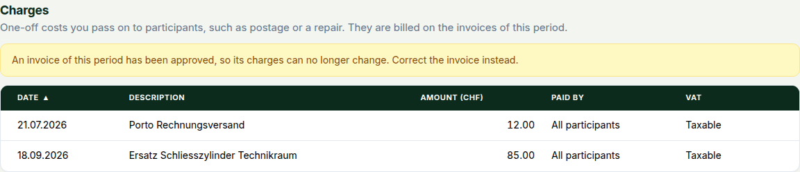

This release lets you bill a one-off cost, such as postage or a repair, to your participants, and lets tools like Grafana read your metering data without a password or database access. The one rule to learn is that a period's charges freeze when its first invoice is approved.

### One-off charges

A cost that happens once does not belong in the tariff list, on the participation contract or in the tariff overview. Record it as a **charge** under **Billing → Invoices**: pick the period, then use **Add charge** in the **Charges** section below the invoice table. Give it a description, the total amount, a date, and who pays, either all participants or a selection. When more than one person pays, the split is equal or by allocation weight. A **Who pays what** table in the dialog shows every share before you save.

Each participant who pays gets the charge as a line under **Other charges**, last on the invoice and PDF.

- **The date decides.** The invoice whose period contains the date bills the charge, and the people who pay are the participants on that date.
- **Shares are rounded one by one**, as for shared fees: CHF 10.00 over three people bills CHF 3.33 each, CHF 9.99 in all. The dialog says so when rounding leaves an amount unrecovered.
- **VAT is your choice.** **Taxable** (the default) adds VAT. **Pass-through** is for an expense you pay in the participant's name and pass on at cost: no VAT is added, and the PDF lists it as *Expenses passed on (no VAT)*. Check with your tax adviser that a cost qualifies. A community that is not VAT-registered, or folds VAT into its prices, bills the charge as entered.

**The period freezes.** Once any invoice of the period is approved, sent or paid, you can no longer add, edit or delete its charges, even those that invoice does not carry. Add all charges first, then regenerate the drafts. Afterwards, correct the invoice or record the cost in a later period. Drafts keep their old lines until regenerated; the period's checklist has a **Charges** step that counts them and warns about a charge nobody pays.

Charges cannot be negative, cannot recur (a monthly fee stays a tariff) and cannot be computed per document. Participants see only the invoice line.

### Analytics data for Grafana and spreadsheets

`GET /api/v1/analytics/series/` returns your consumption and production as rows of local, grid and feed-in energy, from the same numbers as your invoices and dashboards. Pick a granularity from 15 minutes to a year, group by metering point, participant or the whole community, and ask for JSON or CSV (`&format=csv`).

You see what you could already see: managers, viewers and admins get their community, participants only their own rows. A participant gets community-wide totals only when enough participants shared the community on every day of the range: five by default, never fewer than three. An admin sets the number under **Platform → Settings → Security → Analytics privacy**; managers and admins are never held back by it. Requests are bounded, for example 14 days at 15 minutes and 400 at daily, and no more than 300,000 readings; a 25-meter community can query about four months at once. Behind-the-meter data is not included.

For a tool that cannot hold a session, create an **analytics token**: it reads this one endpoint for one community, or only your own data in it, expires after a year by default, and can be revoked alone. Switch it on first under **Platform → Settings → Functions**, because the data leaves OpenZEV for wherever the tool runs; it is off by default. `deploy/grafana/` holds a provisioned Infinity datasource and an example dashboard (self-sufficiency per month, consumption per participant, local versus grid per hour); the user guide chapter *Analytics Data and Grafana* walks through it. Grafana straight on PostgreSQL is not supported.

### Tokens & keys in one place

**Account → API keys** is now **Account → Tokens & keys** (the old `?tab=api-keys` link still opens it). It lists your API keys, analytics tokens and energy data tokens with the same columns: scope, access, last used, expiry. You create API keys and analytics tokens there and revoke any of the three. Energy data tokens are still created with their source, and can now be revoked without deleting it; the source stops receiving until you rotate the token.

An analytics token is visible only to the account that created it. Admins get the same overview across all users under **Platform → Accounts → Tokens & keys**, with filters for user, type and status, and can revoke from there.

### Upgrading

Seven migrations, all additive or relaxing, none rewrites data, no downtime expected:

- `invoices.0026_variable_charges` creates the charge table and adds the **Other** invoice category
- `invoices.0027_invoice_pass_through` adds the pass-through total to invoices
- `invoices.0028_invoice_item_unit_price_width` widens the unit price on invoice lines
- `tariffs.0020_variable_charges` updates the category choices
- `analytics.0001_initial` creates the analytics token table
- `metering.0008_supplementary_push_token_usage` adds creation and last-used times to energy data tokens
- `accounts.0030_appsettings_analytics_min_participants` adds the minimum-community-size setting

New optional settings, all with defaults: `ANALYTICS_MAX_READINGS` (300000), `ANALYTICS_MAX_ROWS` (200000), `ANALYTICS_MIN_PARTICIPANTS_FOR_ZEV_AGGREGATE` (5, now only the default for the setting above) and `ANALYTICS_TOKEN_THROTTLE_RATE` (`1200/hour` per token). Nothing is removed; `GET /auth/api-keys/` stays, and charges and analytics tokens are included in the whole-ZEV export and in backups.

<!-- release-notes-state
version: 1.26.0
source-pr: 1059
triaged:
  1053: section  # one-off charges, backend: engine, VAT, API, archive, backups
  1055: section  # one-off charges, frontend: Charges section, readiness step, invoice grouping
  1056: section  # review fixes for one-off charges: period freeze, wider unit price column
  1072: section  # analytics series endpoint, analytics tokens, Grafana artefacts
  1074: section  # Tokens & keys tab, admin overview, energy token revoke
  1076: section  # admin-set minimum community size, folded into the analytics section; still
                 # open when drafted, to be merged before the cut: drop it from the notes if not
-->
