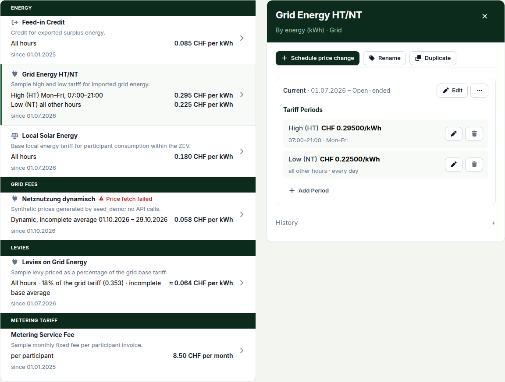

This release makes the SDAT-CH import strict enough to bill from, and makes a late meter-data correction show up on the invoices it affects instead of passing unnoticed. The tariff screen is rebuilt around a detail pane. Read **Upgrading** before you update: production now requires PostgreSQL, and the readings API no longer accepts writes.

### SDAT-CH imports you can bill from

**Metering → Import history → New Import → SDAT-CH (ebIX XML)** now accepts one profile: E66 `ValidatedMeteredData`, 15-minute active energy in kWh, as `.xml` or `.xml.gz`. A file with an unknown meter, a missing interval or a conflicting value is rejected whole, and the protocol names the meter, block and position. Before, such a file imported partly.

A replacement delivery (`Status 5`) with a newer creation time overwrites the values it names; the same file sent twice changes nothing. Temporary values (condition `21`) and information-only deliveries (`C38`) are **held**: stored, never billed, and listed under **Held observations** below the raw readings in **Metering → Chart**. If a meter reports consumption and feed-in under two IDs, enter the second as **Secondary meter ID** on the metering point.

Cancellations (`Status 1`), hourly data and automated exchange are not supported, and the importer has not yet met every grid operator's real files, so check the protocol of your first imports.

### Corrections flag invoices instead of changing them

When an import overwrites readings, CSV or SDAT-CH, or readings are deleted in a period that already has invoices, those invoices get a **Data review** flag naming the delivery or file and the intervals it changed. The invoice itself never changes. The period checklist under **Overview** gains a **Data corrections** step.

A draft only needs **Regenerate invoice**. An issued invoice with payments goes through **Correct invoice → Reverse the invoice**; one without payments has no button yet and is cancelled through the API (`POST /api/v1/invoices/invoices/<id>/cancel/`). Then generate the period again. Participants see the flag on their own invoices, without the evidence. Only changes made after the upgrade are tracked, and editing a historical assignment does not flag anything.

### A tariff opens beside the list

**Setup → Tariffs** opens a tariff in a pane beside the list, and you view and edit it there; the three edit dialogs are gone. On a narrow screen the pane replaces the list, and Back closes it.

You can add the bands while creating a tariff, saved together with it. A dynamic tariff shows its price chart and says when prices are missing for time already passed, rather than leaving you to find out when invoice generation stops.

### Also new

- **Record payment** is in the **More** menu of a sent invoice's row under **Billing**. After a partial payment, **Mark Paid** reads **Mark rest as paid**.
- Managers and viewers can search the audit log under **Setup → Settings → Audit log**; event details open in a pane beside it.
- Closing a dialog with unsaved input asks before discarding it.
- The readiness checklist, period overview, energy dashboard, metering-point list and annual report load faster.

### Fixes worth knowing about

- **An HT/NT tariff billed every hour at HT** when its NT band had no time window: those hours fell through to the first band. Such a band now covers every hour the others leave open, shown as *all other hours*. Issued invoices stay as they are; regenerate affected drafts.
- **An admin impersonating a user could create an analytics token or connect an energy data source** that outlived the session. This is now refused and logged. Check tokens created since 1.26.0 under **Platform → Accounts → Tokens & keys**.
- **An OAuth sign-in could be completed in a different browser** from the one that started it. It is now bound to the starting browser.
- **The audit log stored IBAN changes and a few credential fields unmasked.** New events mask them; older events are unchanged.

### Under the hood

Imports, reading deletions and invoice generation now take one lock per community, and large SDAT-CH files are written in batches of 1,000 rows within one transaction. See ADR 0040 to 0043.

### Upgrading

**PostgreSQL is now required in production.** The lock above works only there. SQLite stays fine for development; MariaDB is no longer supported.

**Breaking changes:**

- `POST`, `PUT`, `PATCH` and `DELETE` on the readings API return `405`. Write readings through a CSV or SDAT-CH import instead.
- A metering point with billable or held readings, or supplementary energy data, can no longer be deleted, moved to another community or change meter type. To retire one, end its assignment and deactivate it.
- Meter IDs, including secondary IDs, must be unique across the instance.
- OAuth callbacks must keep the path `/api/v1/auth/oauth/callback/<slug>/`; a proxy that rewrites it breaks sign-in with `invalid_state`. Sign-ins in progress during the upgrade fail once.

Seven migrations, all additive, no downtime expected:

- `metering.0009`–`0011`: reading source fields, held observations, import-protocol counters
- `invoices.0029`: invoice review flags
- `zev.0046`, `0047`: secondary meter ID and its constraint
- `accounts.0031`: OAuth browser binding

New optional setting `AUDIT_LIST_THROTTLE_RATE` (default `60/minute` per account). ZEV transfer archives are now format 10; older versions cannot read them.

<!-- release-notes-state
version: 1.27.0
source-pr: 1080
triaged:
  1083: section   # SDAT-CH E66 import + invoice data-review flags; breaking API/point changes in Upgrading
  1104: section   # held observations and reading quality, folded into the SDAT section
  1093: hood      # bounded SDAT persistence batches
  1090: omit      # tests/docs for E66 cancellation rejection
  1082: omit      # vendored E66 schema bundle
  1081: section   # tariff split view
  1119: section   # create a tariff with its bands, folded into the tariff section
  1129: section   # dynamic tariff missing-price notice and chart, folded into the tariff section
  1137: section   # pane edit forms, band hours as text
  1139: section   # quieter badges in the tariff pane
  1142: section   # "invoices are not recalculated" hint
  1144: section   # paged fetched-price table
  1140: omit      # tests only
  1120: omit      # ADR 0040 accepted, spec and browser tests
  1141: omit      # duplicating an ended version returned 500; minor
  1118: fix       # band without time window prices all other hours
  1084: also-new  # record payment from the period row menu
  1079: also-new  # audit search for managers/viewers; redaction repair under fixes
  1126: also-new  # audit event pane; overlay drawers retired
  1121: also-new  # universal unsaved-input guard in dialogs
  1122: also-new  # decorative pills and counts removed
  1097: also-new  # page-load performance
  1094: fix       # impersonation could mint durable credentials
  1095: fix       # OAuth state bound to the initiating browser; Upgrading entry
  1125: omit      # button variants / inline styles
  1127: omit      # dialog size names
  1143: omit      # menu focus, phone drawer
  1145: omit      # backup schedule 24-hour time field
  1087: omit      # spacing of scope notices
  1085: omit      # white surface on dynamic source tables
  1015: omit      # UI patterns spec and ADR (docs)
  1091: omit      # release-as 1.27.0 pin
  1124: omit      # deps
  1123: omit      # deps
  1111: omit      # deps
  1110: omit      # deps
  1108: omit      # deps
  1107: omit      # deps
  1105: omit      # deps
  1103: omit      # deps
  1102: omit      # deps
  1101: omit      # deps
  1100: omit      # deps
  1099: omit      # deps
  1098: omit      # deps
  1096: omit      # deps
  1092: omit      # deps
  1088: omit      # deps
  1086: omit      # deps
  1078: omit      # deps
  1004: omit      # deps
not-final:
  1130: open      # perf: reports, dashboard and feasibility loading. If it lands before
                  # the cut, extend the "load faster" line in Also new; no migration.
  1091: action    # remove "release-as" from .github/release-please-config.json right
                  # after 1.27.0 is cut, or every later release stays pinned.
-->
