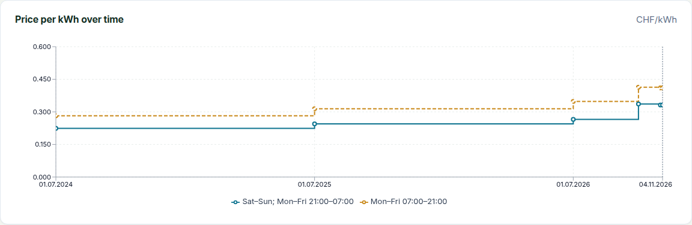

This release adds a notification bell, so you no longer have to come back and look for what happened, and a page that shows what one kWh costs in total and how that moved over time. If you import daily CSV files with 96 values per row, read the first fix below: the longer day of the autumn clock change (25 October 2026) could not be imported.

### Notifications

A bell in the top right corner of every page shows how many notifications you have not read. Select it to see the latest ones; selecting a line marks it read and opens what it is about. **Mark all as read** clears the count, which updates about once a minute.

Participants are told when an invoice is sent to them, when it is paid, and when new data arrived for one of their metering points. Managers are told when an import finished or failed and when invoices were generated for a period, or the generation failed. Several imports for one metering point on the same day show as one line covering all the days. You are not notified of an import you started yourself.

Notifications are events, not warnings: what is wrong right now (a missing price, a gap in the data) stays on the **Billing** overview and the data quality page. A participant only gets notifications once their participation is linked to an OpenZEV account, and a notification disappears from the bell when you lose access to it: the participation ends, the manager access is withdrawn, or the community is disabled. They carry no amounts or names, only what is needed to show the line.

What it does not do: there is no email, push or per-type muting, and nothing arrives in real time. Read notifications are deleted after 30 days, unread ones after 180; set `PRIVACY_NOTIFICATION_READ_RETENTION_DAYS` and `PRIVACY_NOTIFICATION_UNREAD_RETENTION_DAYS` to change this (`0` keeps everything). Notifications are not part of backups or the ZEV export. See [Notifications](https://www.openzev.ch/docs/22-notifications/).

### Price progression

The price history in the tariff pane follows one tariff. To see what **one kWh costs in total**, open the **Tariffs** page and select **Price progression**. It adds up every per-kWh tariff of one energy type (grid, local or feed-in), the way an invoice would price a kWh.

Below the chart, a table breaks one line down on a chosen day into energy, grid fees, levies and metering. Where your VAT setting makes net and gross differ, you can switch between them. Stretches where a category has a gap in its history are shaded and named, because the total there is understated. Monthly, yearly, per-metering-point and shared fees are listed separately and never added to the per-kWh price.

It is read-only, shows the community as a whole rather than a participant's bill, and includes dynamic tariffs only as a monthly average of the fetched prices. If your tariffs combine more than 24 distinct times of use at once, narrow the date range. See [Tariffs](https://www.openzev.ch/docs/07-tariff-configuration/).

### Also new

- **MCP tool `live_energy`** gives an AI assistant the ZEV's current production, consumption, spare power and production forecast, in kW. It is the eleventh tool, for managers, viewers and admins, and only works while live energy data is switched on.
- **Live energy user guide** now covers the push endpoint, Home Assistant and Shelly recipes, and reading your own figures with a personal API key.
- **My energy system** shows its first live figures sooner: the requests now start together with the page instead of one after the other.

### Fixes worth knowing about

- **A daily CSV could not import the autumn clock-change day.** In a file with one row per day and 96 quarter-hour values, the row for the day the clocks go back has 100 values. The importer cut it at 96 and rejected it with "has 100 intervals in Swiss time (DST end), but the row has 96 values", although the file held all 100. 25 October 2026 is such a day. The row is now read in full; a row that really is short is still rejected. If an import log shows this error, upload the file again. Billing, the hourly profile and data quality already handled the day correctly once the readings were in.

### Upgrading

One migration, additive, no downtime expected: `notifications.0001_initial` creates the notification table.

New optional settings, both with working defaults: `PRIVACY_NOTIFICATION_READ_RETENTION_DAYS` (30) and `PRIVACY_NOTIFICATION_UNREAD_RETENTION_DAYS` (180). The privacy sweep gains a notifications step and reports its count in the `privacy.swept` audit event.

<!-- release-notes-state
version: 1.30.0
source-pr: 1191
triaged:
  989: section   # notification center, via 1197
  1197: section  # notification center squash PR
  1117: section  # combined tariff progression, via 1193
  1193: section  # tariff progression implementation
  1192: omit     # spec only, folded into the progression section
  1190: also-new # MCP live_energy tool; live guide additions
  1189: also-new # My energy live requests start with the page
  1196: fix      # 100-value row of the autumn DST day in a 96-value daily CSV
  1195: omit     # dependency bump
  1188: omit     # dependency bump
  1186: omit     # dependency bump
-->
