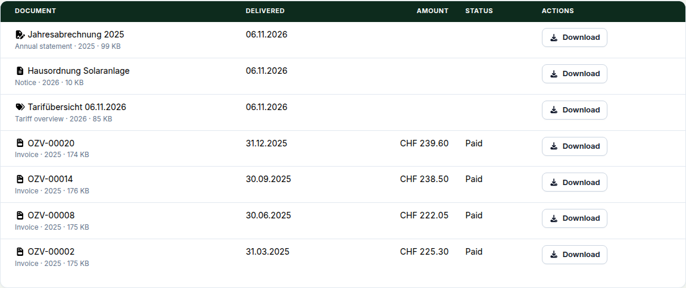
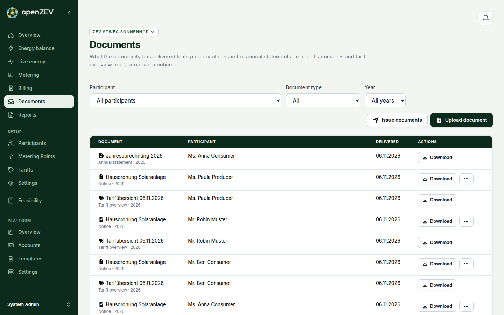

This release gives every participant a document inbox: what the community delivers to them (invoices, credit notes, statements, the contract, notices) is kept as a fixed copy they can open at any time. It also **removes participants' access to the live invoice pages and endpoints**, so run the backfill under *Upgrading* right after you update, or participants will see an empty list.

### Participant document inbox

Participants get **My documents** in the sidebar: everything delivered to them, newest first, filterable by type, year and community.



The amounts and payment state are read live, but the PDF is the copy that was sent. Regenerating an invoice PDF later no longer changes what a participant opens, and the login-free link from the invoice QR code serves the same copy.

Documents do not expire and are not removed when someone leaves the community. A document delivered before an account was linked appears as soon as it is.

Invoices and credit notes arrive on their own: an invoice when it is sent (by email or **Mark as sent**), a credit note when its PDF first exists. Everything else you deliver on purpose, from the new **Documents** page, which also shows what was delivered to whom and flags participants with **No account yet**:



- **Upload document** sends a PDF (up to 10 MB) with a title to everyone in the community or to chosen participants. Only people who are participants *now* receive it; someone who joins later gets nothing.
- **Issue documents** creates the annual statement for a year, the financial summary (producers) or the tariff overview. Issuing again replaces the earlier one in the participant's list, which stays visible there as **Superseded**. Statements are rendered when you issue them, so issue them once the year's invoices are final.
- **Deliver contract to inbox**, in the action menu of a participant on **Participants**, delivers the latest issued contract. It is never automatic, because downloading a contract to print it also issues it.
- **Withdraw** takes an uploaded notice back from participants. Invoices and statements are corrected by issuing again, never withdrawn.

Participants with an account get a bell notification for every delivery. Upload and issue also offer **Also notify participants by email**, off by default: a short mail with a link to **My documents** and no attachment, whose text admins edit under **Platform → Templates → Email templates**. To put that link in the invoice email, add `{inbox_url}` to your template; the default text is unchanged.

**Annual statement** now shows the statement your community issued instead of rendering one on demand. Until you issue one for a year, the page says so. The inbox is also part of backups and of the ZEV transfer archive (tick **Participant documents**; it needs Participants).

It does not offer read receipts, replies, or file types other than PDF. Anonymising a participant is not built yet, and the PDFs carry the participant's name.

### Also new

- **Tariff errors are translated.** Saving a tariff, period, dynamic source or VSE import now reports problems in your language and next to the field they belong to.

### Under the hood

Delivery lives in one new `inbox` app with a single write path, so every document kind is stored, audited and superseded the same way (ADR 0045).

### Upgrading

**Run the backfill first.** Sent invoices and credit notes from before this release have no inbox entry until you create it, and nothing does that for you. From the stack directory:

```
docker compose exec app python manage.py openzev_inbox_backfill --dry-run
docker compose exec app python manage.py openzev_inbox_backfill
```

It delivers the stored PDF of each sent invoice and credit note, dated by when it was sent, and is safe to repeat. It never renders anything: an invoice with no stored PDF, or one whose file is missing from storage, is listed and skipped, and **will not be visible to its participant**. The command's closing message says such documents stay reachable through the live endpoints; that no longer holds after this release. Use **Generate PDF** on each listed invoice (**Billing**) and run the command again. A credit note is delivered when its PDF is regenerated.

**Removed for participants.** `/me/invoices` and the invoice list on the dashboard are gone (the address redirects to **My documents**). For an account that only participates, `GET /api/v1/invoices/invoices/` and `/credits/` return an empty list, their detail and `pdf` routes return 404, and `annual-statement/` and `financial-summary/` return 404. A script using a participant's API key must read `/api/v1/inbox/documents/` instead. Managers and admins keep every route, including for their own participations elsewhere, and the MCP tools are unchanged.

**Tariff API errors.** Error bodies of the tariff endpoints gain a `validation_errors` list of `{code, field, path, params, message}`. Where an endpoint used to answer with a bare array of messages, the array is now wrapped as `{"detail": [...]}`. The web app handles both; a script must too.

Three migrations, all additive: `inbox.0001_initial` (the document table), `0002_contract_held_as_file` and `0003_credit_note_kind`. No downtime is expected.

One optional setting: `INBOX_MAX_UPLOAD_BYTES` (default 10 MB). Transfer archives move to format 11; older archives still import and create no inbox entries.

<!-- release-notes-state
version: 1.31.0
source-pr: 1212
triaged:
  862: section    # participant document inbox (issue)
  1206: section   # inbox core
  1207: section   # transfer archive carries the inbox
  1208: section   # invoices and contracts delivered
  1209: section   # operator documents and issued reports
  1210: section   # participant page, outbox tab, dialogs
  1213: section   # links and notifications
  1214: section   # optional email for documents
  1215: section   # credit notes
  1216: section   # cut-over: participants read from the inbox, live endpoints removed
  1218: omit      # guide screenshots
  1219: section   # one copy per person, UI review findings; the inbox is new, so nothing shipped broken
  1204: omit      # spec, folded into the inbox section
  1203: also-new  # localized tariff API errors; API shape change under Upgrading
  1199: omit      # spec record only
  1205: omit      # dependency bump
  1202: omit      # dependency bump
  1201: omit      # dependency bump
not-final:
  1211: open      # inspect SDAT corrections and resolve invoices (#956). Touches billing
                  # and the invoice detail actions. If it lands before the cut it needs
                  # its own section and a look at the opening paragraph; it adds no
                  # migration per its description.
-->
