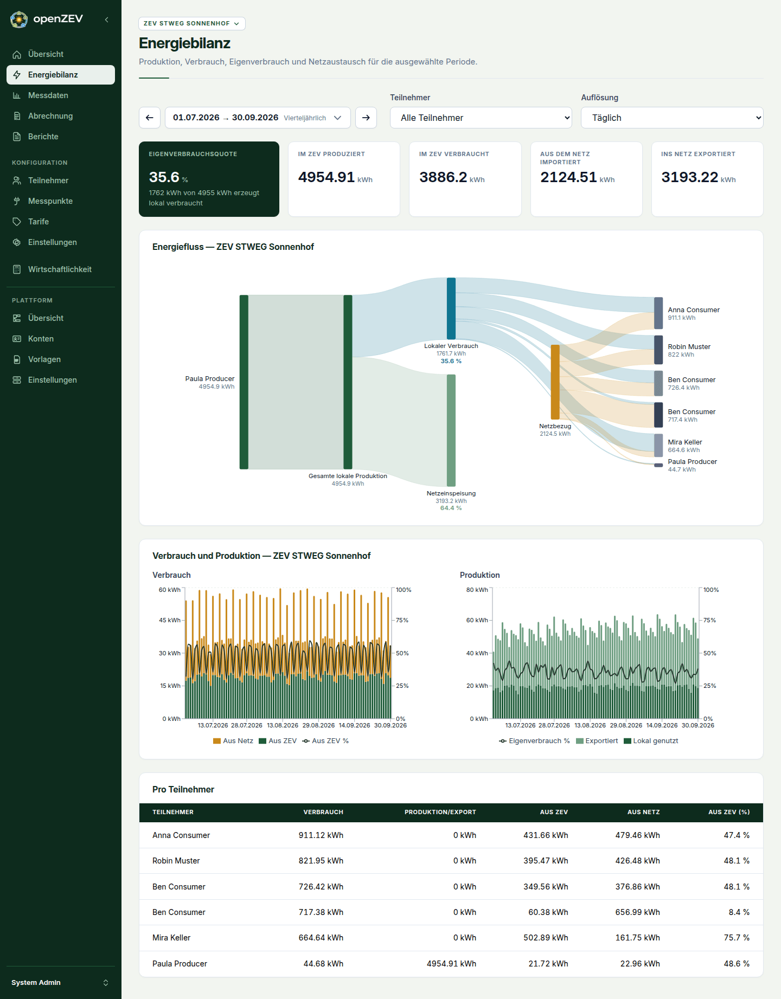
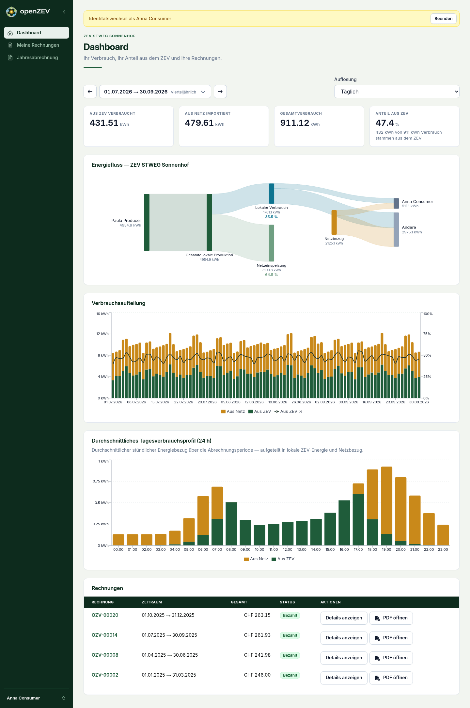
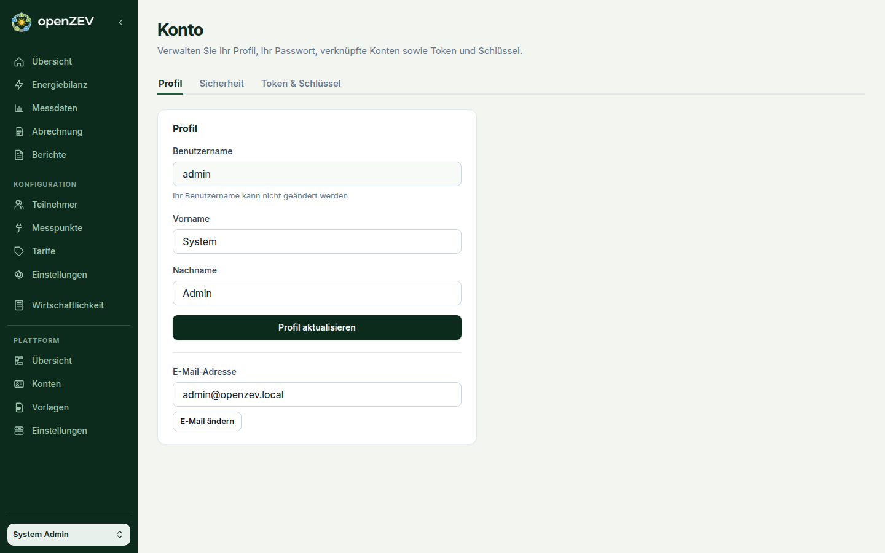

# Getting Started with OpenZEV

This guide covers installing OpenZEV — as a demo, for development, or for
production with Docker Compose or Kubernetes — creating the first admin
account, and a first tour of the interface.

## Choose an Installation

| You want to… | Use | Section |
|---|---|---|
| Try OpenZEV with sample data | `scripts/start-demo-environment.sh` | [Demo and local development](#demo-and-local-development) |
| Work on the code | `docker-compose.dev.yml` | [Demo and local development](#demo-and-local-development) |
| Run it for a real community on one server | `docker-compose.yml` from the release | [Production with Docker Compose](#production-with-docker-compose) |
| Run it on a Synology NAS | Release `docker-compose.yml` in Container Manager | [Synology NAS](#synology-nas-container-manager) |
| Build the production stack from source | `docker-compose.yml` or `docker-compose.fullstack.yml` | [Building from source](#building-from-source) |
| Run it on Kubernetes | Helm chart `charts/openzev` | [Production on Kubernetes (Helm)](#production-on-kubernetes-helm) |

A production instance starts empty: no accounts, no communities. After
installing, [create the first admin account](#creating-the-first-admin-account).

## Prerequisites

- For Docker Compose: Docker with the Compose plugin (or Podman with
  `podman compose`). Building from source also needs a copy of this repository
  (`git clone https://github.com/splattner/openzev.git`)
- For Kubernetes: a cluster, `helm`, `kubectl`, and a PostgreSQL database and
  Valkey (or Redis) instance the cluster can reach
- For a public instance: a domain name, TLS termination (a reverse proxy or
  ingress with a certificate), and an SMTP account for outgoing mail
- Basic familiarity with the terminal
- A modern web browser

## Demo and local development

Keep frontend, backend, and worker separated for cleaner scaling and easier operations. To start the stack and seed the full demo dataset in one step:

```bash
scripts/start-demo-environment.sh
```

The script creates `backend/.env` from `backend/.env.example` (development
defaults) when it does not exist yet, and refuses to run when `backend/.env`
disables `DEBUG` (a production configuration) instead of seeding it.
For day-to-day development with live
reload, use the dev stack instead:

```bash
cd /path/to/openzev
docker compose -f docker-compose.dev.yml up -d --build
```

Wait a few seconds for services to start, then access:

- **Frontend (UI):** http://localhost:8080 (dev stack: http://localhost:5173)
- **Backend API:** http://localhost:8080/api/v1/ (dev stack: http://localhost:8001)
- **Database:** localhost:5432 (PostgreSQL, dev stack only)
- **Message Broker:** localhost:6379 (Valkey, dev stack only)

To stop the dev stack:

```bash
docker compose -f docker-compose.dev.yml down
```

Never use either of these for real data: they run with `DEBUG=True`, and the
demo seed ships well-known passwords.

## Production with Docker Compose

Each release ships a ready-made `docker-compose.yml` that runs the published
OpenZEV images — nothing is built on your server. It starts the application
(`app`: nginx serving the frontend and proxying `/api/` to Django/gunicorn in
the same container), a Celery worker, one Celery Beat scheduler, PostgreSQL and
Valkey on one host. Only the loopback-bound port `127.0.0.1:8080` is published;
PostgreSQL and Valkey are reachable only on the compose network. The images are
signed with cosign and come with an SBOM.
Keep the shared Valkey cache supplied by Compose: registration reservations and
throttles must be shared across backend workers; an in-memory cache is local to
each process.

### 1. Download the release files

Pick the newest release on the
[releases page](https://github.com/splattner/openzev/releases) and download
`docker-compose.yml` and `env.production.example` into an empty directory:

```bash
mkdir openzev && cd openzev
VERSION=vX.Y.Z   # the newest release tag
curl -LO https://github.com/splattner/openzev/releases/download/$VERSION/docker-compose.yml
curl -LO https://github.com/splattner/openzev/releases/download/$VERSION/env.production.example
```

The compose file pulls the image of the release it was published with, so the
version is pinned by the file you download. To run a different version without
changing the file, add `OPENZEV_VERSION=vX.Y.Z` to `.env`.

### 2. Configure `.env`

```bash
cp env.production.example .env
```

Fill in every value. The examples below assume the instance is reached at
`https://zev.example.ch`. By default the frontend port is published on loopback
(`127.0.0.1:8080`) for a TLS proxy on the same host.
[Step 4](#4-put-https-in-front-of-it) also covers a private container network.

| Setting | Example | Notes |
|---|---|---|
| `SECRET_KEY` | *(generated, see below)* | The backend refuses to start without it |
| `DJANGO_ADMIN_ENABLED` | `False` | Keeps Django's separate `/admin/` login disabled. Use the platform pages for normal administration; enable Django admin only behind a private network or ingress/nginx allowlist. |
| `ALLOWED_HOSTS` | `zev.example.ch` | Bare hostname(s), comma-separated, no scheme or port |
| `CSRF_TRUSTED_ORIGINS` | `https://zev.example.ch` | Full public origin — set it even though CORS stays empty |
| `CORS_ALLOWED_ORIGINS` | *(empty)* | Leave empty: nginx serves the UI and the API from the same origin |
| `FRONTEND_URL` | `https://zev.example.ch` | Used for links in emails and for redirects |
| `EMAIL_HOST`, `EMAIL_PORT`, `EMAIL_USE_TLS`, `EMAIL_HOST_USER`, `EMAIL_HOST_PASSWORD`, `DEFAULT_FROM_EMAIL` | your SMTP account | Needed for invitations, password resets and invoice emails — see [Email Configuration](10-email-configuration.md) |
| `WEBAUTHN_RP_ID` | `zev.example.ch` | Bare domain for passkeys; changing it later invalidates every registered passkey |
| `WEBAUTHN_ORIGIN` | `https://zev.example.ch` | Full origin for passkeys |
| `MFA_ENCRYPTION_KEYS` | *(generated, see below)* | Encrypts two-factor secrets; without it nobody can enrol an authenticator app |
| `BACKUP_ENCRYPTION_KEYS` | *(generated, see below)* | Encrypts backup archives; without it backups are written unencrypted — see [Backups](18-backups.md) |
| `INTEGRATION_ENCRYPTION_KEYS` | *(optional, a Fernet key as for `MFA_ENCRYPTION_KEYS`)* | Encrypts the API keys participants enter to connect Solar Manager. Setting it also switches the [own energy data](20-energy-data.md) feature on (an admin can still switch it off); without it only push and file sources work |

**OAuth upgrades:** new accounts need `email_verified: true` unless an admin
enables **Allow missing email-verification claim** for a trusted provider that
omits it. Review the [OAuth upgrade requirements](14-admin-console.md#oauth)
before upgrading an existing deployment.

Generate the three keys with Python (any machine with Python 3; the
`cryptography` package is only needed for the second line):

```bash
python3 -c "import secrets; print(secrets.token_urlsafe(50))"                               # SECRET_KEY
python3 -c "from cryptography.fernet import Fernet; print(Fernet.generate_key().decode())"  # MFA_ENCRYPTION_KEYS
python3 -c "import base64, os; print(base64.urlsafe_b64encode(os.urandom(32)).decode())"    # BACKUP_ENCRYPTION_KEYS
```

Store a copy of all three keys outside the server. Losing
`MFA_ENCRYPTION_KEYS` makes enrolled authenticator apps unusable, and losing
`BACKUP_ENCRYPTION_KEYS` makes encrypted backups unreadable.

What each key protects, and what losing it costs:

| Key | Protects | If lost |
|---|---|---|
| `BACKUP_ENCRYPTION_KEYS` | Backup archives **and stored destination credentials** | Encrypted backups and stored S3 secrets needing that key cannot be opened. Keep old keys while retained archives or stored secrets still depend on them; new backups alone do not re-encrypt stored credentials. See [Backups](18-backups.md). |
| `INTEGRATION_ENCRYPTION_KEYS` | Participants' Solar Manager API keys | Those connections cannot be read and show *Reconnect needed*; each participant enters their key again. Nothing else is affected. Keep old keys in the list while you rotate (`manage.py rotate_integration_key`). |
| `MFA_ENCRYPTION_KEYS` | Two-factor (TOTP) secrets | Authenticator access is affected; it is not the key that opens a backup archive. It is needed when recovering those devices. |
| `SECRET_KEY` | Signing and authentication state | Replacing it can invalidate sessions and tokens; it does not make the backed-up business data undecryptable. |

The backend checks this configuration every time it starts. If a required
value is missing or still points at a development host, the database
migration step stops with an error such as `accounts.E003` (hosts),
`accounts.E005` (trusted origins) or `accounts.E006` (email backend), and the
`app` container exits — read it with `docker compose logs app`.

### 3. Start the stack

```bash
docker compose up -d
docker compose ps
```

The first start pulls the images. The application applies database migrations on every start. The `beat` container
may exit once on the very first start, before those migrations have created
its tables; it restarts on its own.

### 4. Put HTTPS in front of it

With `DEBUG=False` the login and CSRF cookies are marked `Secure`, so browsers
only send them over HTTPS — and the production template redirects HTTP to
HTTPS (`SECURE_SSL_REDIRECT=True`). A public instance therefore needs TLS
termination. A host-installed proxy reaches `http://127.0.0.1:8080`; a
containerized proxy reaches `app:8080` on a private container network, with
the application's host port publication removed. Only trusted proxies may
reach this nginx endpoint: they must overwrite `X-Forwarded-Proto` with the
external scheme (`https` for HTTPS requests), or redirects can loop.
Open the app at the public `https://` URL. Only an explicitly isolated local
smoke test should set `SECURE_SSL_REDIRECT=False`.

Initially set `SECURE_HSTS_SECONDS=0`. After verifying the public HTTPS origin,
set it to `31536000`: browsers then require HTTPS for one year after receiving
the header over a valid HTTPS connection.

**Caddy** obtains and renews the certificate on its own. With Caddy installed
on the same host, this is the whole `Caddyfile`:

```caddyfile
zev.example.ch {
    reverse_proxy 127.0.0.1:8080
}
```

If Caddy runs as a container in this compose project instead, put it on the
same private network, remove the application's `ports` mapping, and point it
at the service: `reverse_proxy app:8080`.

**Traefik** (v2 or v3, with the Docker provider, an HTTPS entry point and a
certificate resolver you already run) routes by container labels. Add a
`docker-compose.override.yml` next to `docker-compose.yml`; Compose merges it
automatically. It joins `app` to Traefik's network and stops publishing port
`8080`, so the only way in is through Traefik:

```yaml
services:
  app:
    ports: !reset []            # needs Docker Compose 2.24 or later
    networks:
      - default
      - proxy
    labels:
      - traefik.enable=true
      - traefik.docker.network=proxy
      - traefik.http.routers.openzev.rule=Host(`zev.example.ch`)
      - traefik.http.routers.openzev.entrypoints=websecure
      - traefik.http.routers.openzev.tls.certresolver=letsencrypt
      - traefik.http.services.openzev.loadbalancer.server.port=8080

networks:
  proxy:
    external: true              # the network Traefik is attached to
```

Replace `proxy`, `websecure` and `letsencrypt` with the network, entry point
and resolver names from your Traefik setup, and `zev.example.ch` with your
domain. On older Compose versions, delete the `ports` line and remove the
`127.0.0.1:8080:8080` mapping from `docker-compose.yml` by hand.

The shipped nginx sanitizes `X-Forwarded-For` and the production stack keeps
`NUM_PROXIES=1`. The outer TLS terminator is therefore part of the trust
boundary: users share its audit address and per-IP throttle bucket. Increasing
`NUM_PROXIES` cannot recover client addresses that nginx discarded; see the
[proxy reference](../../charts/openzev/README.md#reverse-proxies-and-num_proxies)
before changing this topology.

> **`/media/` is never web-served in production** — invoice files are served
> only through authenticated API endpoints.

### 5. Create the first admin account

See [Creating the first admin account](#creating-the-first-admin-account) below.

### 6. Back up and update

> **Credential-provenance upgrade:** when upgrading across `accounts.0028`/`0029`,
> use the [maintenance rollout](../credential-provenance-upgrade.md) instead of
> the ordinary restart commands below. Old and new authentication workers must not overlap.

- Set up backups of the database **and** the `backend_media` volume (invoice
  PDFs) before billing real participants — see [Backups](18-backups.md).
- To update, download `docker-compose.yml` of the new release over the old
  one (or set `OPENZEV_VERSION=vX.Y.Z` in `.env`), then pull and restart;
  migrations run automatically when the application starts. Read the release
  notes first, and make a backup before upgrading:

  ```bash
  docker compose pull
  docker compose up -d
  ```

When upgrading from a release that shipped Redis, the message broker and cache
service is now Valkey, a Redis-compatible server, and the compose service is
called `valkey` instead of `redis`. Nothing needs to be migrated: the broker
and cache hold no data you need to keep (queued tasks are short-lived and the
cache refills itself), and the connection URLs keep the `redis://` scheme.
Run `docker compose up -d --remove-orphans` once to remove the old `redis`
container. If you run your own Redis instead of the bundled one, you do not
have to replace it. On Kubernetes, `valkey.url` / `valkey.cacheUrl` replace
`redis.url` / `redis.cacheUrl` in the Helm values; the old keys keep working
when set (see the [chart README](../../charts/openzev/README.md#upgrading-from-redis)).

When upgrading to the participant-link protection, existing independent accounts
keep their passwords, sessions and API keys. If the update happens between the
password and two-factor steps, restart sign-in; the old challenge is no longer
accepted.

**First upgrade to the hardened images:** the container's HTTP port changes
from 80 to 8080, host publication becomes loopback-only, and processes run as
UID/GID 10001. Replace the release Compose file and update custom proxy ports;
direct LAN access to `http://server:8080` is replaced by the HTTPS proxy above.
HTTP now redirects by default, and HSTS defaults to one year. Verify HTTPS
with `SECURE_HSTS_SECONDS=0` before enabling HSTS.

Back up the database and media, then stop every application writer before
migrating existing media ownership. For the downloaded release stack:

```bash
docker compose stop app worker beat
docker compose pull
docker compose run --rm --no-deps --user root app chown -R 10001:10001 /app/media
docker compose up -d
docker compose ps
```

Confirm that sign-in works over HTTPS and that an upload and invoice PDF
generation succeed. See [Building from source](#building-from-source) for
source-stack migration commands; Kubernetes operators should also read the
[chart upgrade guidance](../../charts/openzev/README.md#production-hardening).

### Synology NAS (Container Manager)

On a Synology NAS the release file runs as a *Project* in **Container Manager**
(called *Docker* before DSM 7.2). You need DSM 7.2 or later on a model that
supports Container Manager.

1. In **File Station**, create a folder for the stack, for example
   `docker/openzev`, and copy `docker-compose.yml` into it (download it as in
   [step 1](#1-download-the-release-files)).
2. Fill in the settings from [step 2](#2-configure-env) and save them as a file
   named `.env` in the same folder — for example by editing
   `env.production.example` on your computer and uploading it as `.env`.
   File Station hides names that start with a dot; the file is still there.
3. Open **Container Manager → Project → Create**, enter a name such as
   `openzev`, choose the folder as the **Path**, and pick **Use existing
   docker-compose.yml**. Click through the remaining pages and finish with
   **Done**. DSM pulls the images and starts the stack.
4. Create the first admin account as in
   [Creating the first admin account](#creating-the-first-admin-account). Use
   the project's `app` container: SSH into the NAS and run
   `sudo docker compose exec app …` from the project folder, or open a
   terminal on the `app` container under **Container Manager → Container**.

Things that differ from a plain Linux server:

- **Port.** The stack publishes `8080`. If another package already uses it,
  change the host port in `"127.0.0.1:8080:8080"` in `docker-compose.yml`, for
  example `"127.0.0.1:8088:8080"`, and use that port below.
- **HTTPS.** Let DSM terminate TLS: get a certificate under **Control Panel →
  Security → Certificate**, then add a rule under **Control Panel → Login
  Portal → Advanced → Reverse Proxy** from `https://zev.example.ch` (port 443)
  to `http://localhost:8080`. Set `ALLOWED_HOSTS`, `CSRF_TRUSTED_ORIGINS`,
  `FRONTEND_URL` and the passkey settings in `.env` to that address as in
  step 2, and forward the name and ports from your router. Configure the proxy
  to send `X-Forwarded-Proto: https` for HTTPS requests, as required by
  [step 4](#4-put-https-in-front-of-it).
- **Updating.** Follow the [upgrade warning](#6-back-up-and-update) before restarting.
  Replace `docker-compose.yml` with the new release's file (or
  set `OPENZEV_VERSION` in `.env`), then over SSH run `sudo docker compose pull`
  followed by `sudo docker compose up -d` in the project folder. Make a backup
  first. On the first upgrade to UID 10001, also follow the
  [media ownership migration](#6-back-up-and-update).
- **Backups.** The database and invoice files live in Docker volumes, which
  DSM's own backup tools do not include by default. Set up the backups
  described in [Backups](18-backups.md), and send them to a location outside
  the NAS.

### Building from source

To build the images yourself — for a patched checkout, or a platform the
published images do not cover — use a copy of the repository instead:

```bash
git clone https://github.com/splattner/openzev.git
cd openzev
git checkout vX.Y.Z   # pick the newest release tag; main may be unstable
cp backend/.env.production.example backend/.env   # then fill it in as in step 2
docker compose -f docker-compose.fullstack.yml up -d --build
```

`docker-compose.fullstack.yml` is the same single-application-container stack
as the release file, built locally and reading `backend/.env`. The repository
also contains `docker-compose.yml`, which builds the frontend (nginx) and the
backend as two containers. Both use the [HTTPS proxy setup](#4-put-https-in-front-of-it)
above. Pass `-f docker-compose.fullstack.yml` to every `docker compose` command
for the fullstack stack. To update, back up the database and media, check out
the new tag, then rebuild and restart, subject to the
[upgrade warning](#6-back-up-and-update).

On the first upgrade from root-running images, migrate ownership while writers
are stopped. For source-built fullstack:

```bash
docker compose -f docker-compose.fullstack.yml stop app worker beat
docker compose -f docker-compose.fullstack.yml build
docker compose -f docker-compose.fullstack.yml run --rm --no-deps --user root app chown -R 10001:10001 /app/media
docker compose -f docker-compose.fullstack.yml up -d
```

For the split frontend/backend source stack:

```bash
docker compose stop backend worker beat
docker compose build
docker compose run --rm --no-deps --user root backend chown -R 10001:10001 /app/media
docker compose up -d
```

Verify uploads and invoice PDF generation after either migration.

## Production on Kubernetes (Helm)

The Helm chart deploys the frontend, backend, a Celery worker, one Celery Beat
scheduler, an Ingress and a volume for invoice files. It does **not** deploy
PostgreSQL or Valkey (Redis works too) — provide both yourself (a managed service or a separate
chart).

1. Create secrets for the database URL, Django `SECRET_KEY`, the SMTP password
   and the encryption keys (generate the keys as shown in
   [step 2](#2-configure-env) above).
2. Write a `values-prod.yaml` with your domain, trusted origins, passkey
   domain, database and Valkey endpoints, SMTP settings and ingress. The
   [chart README](../../charts/openzev/README.md#example-values) has a
   complete example — start from it.
3. Install:

   ```bash
   helm repo add openzev https://splattner.github.io/openzev
   helm repo update
   helm upgrade --install openzev openzev/openzev -n openzev --create-namespace -f values-prod.yaml
   ```

4. [Create the first admin account](#creating-the-first-admin-account).

For an existing installation crossing the credential-provenance boundary, follow
the [maintenance rollout](../credential-provenance-upgrade.md); a normal rolling
Helm upgrade is insufficient.

The ingress needs TLS for the same reason as above (`Secure` cookies), and the
backend runs the same configuration check on start. For every chart value,
including TLS, existing secrets and `NUM_PROXIES` behind an ingress, see the
[chart README](../../charts/openzev/README.md).

For an existing media PVC, see the chart's [media upgrade guidance](../../charts/openzev/README.md#media-pvc)
before switching from root-owned files to UID 10001.

## Creating the First Admin Account

A fresh production instance has no accounts, and the login page has no way to
create an admin. Create the first one from the command line with Django's
`createsuperuser` command, run inside the backend container. It asks for a
username, an email address and a password:

```bash
# Docker Compose (release docker-compose.yml)
docker compose exec app python manage.py createsuperuser

# Built from source with the two-container docker-compose.yml
docker compose exec backend python manage.py createsuperuser

# Kubernetes (release "openzev" in namespace "openzev")
kubectl -n openzev exec -it deploy/openzev-backend -- python manage.py createsuperuser
```

The account gets the **admin** role. You sign in with the **email address**,
not the username. The password must pass the usual strength checks (at least
8 characters, not entirely numeric, not a common password).

To create the account from a script instead of interactively, pass the
password through the environment:

```bash
docker compose exec -e DJANGO_SUPERUSER_PASSWORD='choose-a-strong-password' app \
  python manage.py createsuperuser --noinput --username admin --email admin@example.ch
```

Then:

1. Open the instance in the browser and sign in with that email address and
   password.
2. Under **Account → Security**, turn on two-factor authentication or add a
   passkey for the admin account.
3. Create the other people's accounts in **Platform → Accounts → Users**, or
   create a community and its first manager with the wizard in **Platform → ZEVs** —
   see [Platform Administration](14-admin-console.md).
4. Decide whether strangers may sign up. **Self-registration is on by
   default**: anyone who can reach the login page can register an account
   and create a community, which makes them its issuer and manager. On a public instance you run only for your
   own community, turn it off under **Platform → Settings → Functions**,
   or set `FEATURE_ZEV_SELF_REGISTRATION_ENABLED=false` in `.env`.

Use `createsuperuser` again whenever you need another admin and cannot sign in
— for example, if the only admin account was locked out.

## Demo Accounts

A demo dataset is available for testing. It is loaded by starting the stack
with `scripts/start-demo-environment.sh`, or by running `seed_demo` on an
already-running stack (see below). It contains two communities with the
same issuer — the flagship **ZEV STWEG Sonnenhof** and the smaller
**ZEV Sonnenfirma AG** — so both sides of the community choice have real
data to show. It also has a viewer of the flagship community and a property
manager who manages both, to show per-community access.

Seeded demo users:

- Admin: `admin@openzev.local` / `admin1234`
- Issuer and manager: `owner@openzev.local` / `owner1234`
- Participant (ZEV 1): `anna@openzev.local` / `anna1234`
- Participant (ZEV 1, flat 2 + parking space with charger): `ben@openzev.local` / `ben1234`
- Participant (ZEV 2): `clara@openzev.local` / `clara1234`
- Viewer (ZEV 1, read-only): `viewer@openzev.local` / `viewer1234`
- Property manager (both ZEVs): `manager@openzev.local` / `manager1234`
- Former participant (ZEV 1, moved out): `former@openzev.local` / `former1234`
- Joint household (ZEV 1): `household@openzev.local` / `household1234`
- Organisation participant (ZEV 1): `organisation@openzev.local` / `organisation1234`
- Manager of ZEV 1 by grant + participant of ZEV 2: `mixed@openzev.local` / `mixed1234`
- Viewer of ZEV 1 until 31 March next year (Treuhand): `treuhand@openzev.local` / `treuhand1234`
- No ZEV yet, may set one up: `newcomer@openzev.local` / `newcomer1234`
- Pending invitation (ZEV 2 viewer, no password yet): `invitee@openzev.local`

"Last year" below means the year before `--end-date`.

- **Dated issuer:** Otto Vorbesitzer (no login) issued the flagship's invoices until
  30 June last year, Paula Producer from 1 July.
- **Tenant change:** Maria left flat 3 after Q1 last year and the Musters took over the
  same meter. Maria's login shows only her one invoice; she has moved away since, and
  that invoice keeps her old address.
- **Parties that are not participants:** the Verwaltung Muster AG represents the
  flagship and manages it through that role; Hans Hauswart is a contact without access.
- **Landowners:** each house of the second ZEV has its own (Paula, Clara, Lukas). The
  role grants no access.

The seed command creates two communities owned by the same demo owner, so the community switcher can be exercised:

- **ZEV STWEG Sonnenhof** — the flagship, a single-building condominium (`zev`) with quarterly billing, German invoices and VAT folded into its prices. Carries participants, metering points, tariffs and hourly readings from 1 January of the previous year through the seed window, with 15-minute readings only for its latest 14 days. The previous year is billed quarter by quarter as paid invoices, except when its final quarter overlaps the open prior quarter; that prior quarter has draft, approved and sent invoices.
- **ZEV Sonnenfirma AG** — a smaller property-company (`vzev`) with monthly billing, English invoices, VAT-registered with a UID, shared grid-connection and per-metering-point fees, and itemized tariff bands. Carries its own participants, metering points, tariffs and readings, plus two invoice periods: the prior complete month in draft/approved/sent and the month before it closed (paid/cancelled).

The standard Swiss VAT ranges (7.7 % from 2018 and 8.1 % from 2024) are added only when no existing rate overlaps each range; existing VAT timelines are preserved. The operational/log pages are seeded too — metering import logs (CSV + SDAT-CH, with CSV provenance on a real meter month), invoice email logs, two issued contract snapshots (Anna and Clara), stored PDFs for Anna's sent and paid invoices, and audit events (including one denied) — and one meter on the flagship carries an intentional ~12-day reading gap in the current quarter so the data-quality page has a real issue to show.

The flagship also carries **Netznutzung dynamisch**, linked to a synthetic price
source with quarter-hourly prices from the start of the quarter containing
`--end-date` through the following day. The tariff starts after all seeded
invoice periods, so their totals are unchanged. Fetching is disabled and the
source URL is a reserved `.invalid` host, so seeding never calls a tariff API.
Re-seeding keeps the stored prices.

Re-running `seed_demo` refreshes the demo readings, invoices and Anna's PDFs, import/email logs and audit events, while retaining contract snapshots. If the seed transaction rolls back, existing invoice rows and PDFs remain unchanged. PDF generation and cleanup run after commit and are best-effort. Screenshot captures explicitly select ZEV STWEG Sonnenhof so they consistently show the same community.

### Resetting Demo Data

To reload the demo dataset:

```bash
docker compose exec backend python manage.py seed_demo
```

This refreshes demo readings, invoices, import/email logs and audit events for
both communities, and fills the synthetic dynamic-price series through tomorrow.
Its stored price history and issued contract snapshots are retained.

By default, `--end-date` is today and `--start-date` is the start of the
complete quarter before that end date. Both dates accept `YYYY-MM-DD`; use
`--end-date` to reproduce a historical window and `--start-date` to override
its default start.


## First-Time Setup

This tour uses the demo accounts. On a production instance, sign in with the
admin account you [created above](#creating-the-first-admin-account); the
pages look the same, just without data.

### 1. Login

1. Navigate to http://localhost:8080 (or your instance's `https://` URL)
2. Login with admin credentials (or a manager's account to manage a community)
3. Managers land on **Overview**; participants land on their personal dashboard.
   Unlinked guest accounts see an explanation and a link to **Account settings**.

The interface follows your browser's language (German, French, Italian or
English). To change it, open the account menu at the foot of the sidebar
(your name) and pick a **Language**; the choice is remembered in this browser.
The same menu leads to **Account** settings and **Log out**, and its last line shows the OpenZEV version with a link to the source code. Invoice and
contract PDFs use the community's own **Invoice language** instead.


Overview, Energy balance, Reports, Billing, community Settings and Metering
offer **Retry** if the community list fails to load. A failed refresh keeps
the previous community and its content visible with a warning.

If no community is available, an admin can open **ZEVs** to create one; an
account without community access should ask an administrator to grant it.

### 2. Explore as Admin

If logged in as admin:
- Go to **Platform → Overview** to see system-wide KPIs
- View **ZEVs**, **Accounts**, **Invoices**, and **Settings** (regional/VAT)
- To work inside a community: open **Platform → Overview → ZEVs** and click **Manage** on a row — this selects the ZEV and takes you to its operational Overview. (Under `/admin` pages show **Platform administration** above the title instead of a community.)
- Anywhere else, the community name above the page title shows the working community and, when you have more than one, opens the list to choose another — so it stays visible and in reach when the navigation scrolls, the sidebar is collapsed, or you are on mobile. With more than one community it is set as a small button with an arrow. With read-only access it reads e.g. *Sonnenhof · Viewer (read only)*
- For keyboard access, open the community name or the account button with Enter or Space, move through the options with the arrow keys (community list) or Tab (account menu), and press Escape to close it. After choosing a community, focus returns to its name. On mobile, Escape closes the navigation drawer and returns focus to its menu button.
- Once signed in, the first Tab on a page reaches **Skip to main content**, which jumps past the navigation. After you open another page, focus starts at its title; switching tabs or changing filters keeps focus where it was. The browser tab shows the page and the community, e.g. *Billing · Muster ZEV – OpenZEV*.

### 3. Explore as a Manager

If logged in as a community's manager:
- Go to **Overview** for setup guidance and billing work grouped by period
- Go to **Energy balance** to analyse production, consumption, self-consumption, and grid exchange for a period
- Go to **Settings** to configure your community parameters (General · People & access · Billing & payment · Documents & emails · Audit log · Export/transfer)
- Go to **Participants** to view member list
- Go to **Metering Points** to see participant meters
- Go to **Metering** for consumption charts, data quality, and import history
- Go to **Tariffs** to configure energy pricing
- Go to **Billing** to generate and manage invoices and inspect/retry email delivery
- Go to **Reports** for the annual report (self-consumption, self-sufficiency, participant savings), annual statements, and tax overviews




Energy-flow cards name the selected community in both Energy balance and the
participant dashboard.

Consumption and production charts in **Energy balance** stack when the panel
is narrow.

The **Energy balance** and participant dashboard date selectors update the
page URL. Bookmark or share a link with `period_start` and `period_end` to
return to that exact range, including a custom range, after reload or browser
Back. Without a valid range the page opens the current period. Switching
community or changing its billing interval resets the dashboard to the current
period. Switching community also clears any selected participant.

In the participant table, Tab to a name and press Enter or Space to filter the
charts; swipe the table horizontally on narrow screens to see every column.
The selected participant’s name stays visible while the energy overview loads
or cannot load. Use **Retry** if the consumption profile fails.

### 4. View as Participant

Login as a participant (Anna or Ben):
- **Dashboard** shows your selected community's energy overview and your invoices from all communities
- **My invoices** lists your invoices with details and any available PDFs
- **Annual statement** shows your yearly statement and financial summary

Anna's demo account includes invoice PDFs; Ben's invoices show without PDFs.
Invoice details and available PDFs remain accessible while the energy overview
loads or fails. The consumption profile loads separately; use **Retry** if it
fails.



Your consumption cards, chart and energy flow include personal-meter
consumption and your weighted community-meter share, even without a personal
meter. When several current records have consumption, the flow combines them
into a **Total consumption** node. Disabled communities contribute no consumption.



## Dialogs and actions

Use Tab or Shift+Tab to move between dialog controls. Escape closes an open
dropdown or calendar first; otherwise Escape or **Close** dismisses the dialog. Background controls are unavailable until the top dialog
closes. Before submitting a confirmation, choose **Cancel** to
leave without starting the action. While it is processing, **Close** dismisses
the dialog and the action continues; failures are still reported. If an action
fails, reopen its confirmation to retry.

## API Access

OpenZEV provides a complete REST API for programmatic access:

- **Swagger UI:** http://localhost:8080/api/docs/
- **ReDoc:** http://localhost:8080/api/redoc/
- **API Base URL:** http://localhost:8080/api/v1/

Development stack (`docker-compose.dev.yml`) serves the API directly on port 8001.

The API is protected by JWT authentication. Demo credentials work for API access too.

## Prebuilt Container Images

If you prefer not to build locally, prebuilt images are available on GitHub Container Registry:

- `ghcr.io/splattner/openzev-backend` — the Django API
- `ghcr.io/splattner/openzev-frontend` — the static frontend served by nginx
- `ghcr.io/splattner/openzev-fullstack` — frontend and backend in one container, which the release `docker-compose.yml` uses

Tag variants:
- `latest` — newest published release
- `vX.Y.Z` — specific release version
- `main` — latest build from the `main` branch
- `main-<short-sha>` — the build of one specific `main` commit

Images tagged `main` are rebuilt on every commit to `main` and may contain
unfinished changes or breaking behaviour. Use them for previews only; for a
reproducible deployment pin a release tag such as `v1.2.3`.

### SBOMs and signatures

Release images and `main` images are published with signed container manifests
and signed SBOM attestations. Release SBOM files are attached to the GitHub
release; `main` SBOMs are uploaded as artifacts of the `Container Build Check`
workflow run. An SBOM is verified through the signed attestation bound to the
image, not through a detached signature on the raw `.spdx.json` file.

With [`cosign`](https://docs.sigstore.dev/cosign/) installed, verify an image's
GitHub OIDC keyless signature (for a release image, replace `:main` with the
release tag, for example `:v1.2.3`):

```bash
cosign verify \
  --certificate-identity-regexp "https://github.com/splattner/openzev/.github/workflows/.*" \
  --certificate-oidc-issuer "https://token.actions.githubusercontent.com" \
  ghcr.io/splattner/openzev-backend:main
```

Verify the signed SBOM attestation the same way:

```bash
cosign verify-attestation \
  --certificate-identity-regexp "https://github.com/splattner/openzev/.github/workflows/.*" \
  --certificate-oidc-issuer "https://token.actions.githubusercontent.com" \
  --type spdxjson \
  ghcr.io/splattner/openzev-backend:main
```

To inspect the attested predicate, append `| jq '.payload | @base64d | fromjson'`,
or download the `.spdx.json` file from the release or workflow run.

### Reverse proxies and NUM_PROXIES

Follow [step 4](#4-put-https-in-front-of-it) for the production Compose
topologies, or the [proxy reference](../../charts/openzev/README.md#reverse-proxies-and-num_proxies)
for custom proxies and Kubernetes. Development keeps `NUM_PROXIES=0` because
its backend is directly accessible; requests through Vite may share a
rate-limit bucket.

## What's Next?

- **Operators:** See [ZEV Setup and Configuration](02-zev-setup.md)
- **Data Management:** See [Metering Imports](05-metering-import.md)
- **Billing:** See [Tariff Configuration](07-tariff-configuration.md)
- **Understanding Roles:** See [Roles and Permissions](11-roles-and-permissions.md)

## Troubleshooting

### Services won't start

Check Docker logs:

```bash
docker compose logs
```

### Can't access frontend

- Ensure port 8080 is not in use: `lsof -i :8080`
- Check Docker container is running: `docker compose ps`

### Database connection errors

Verify PostgreSQL container is healthy:

```bash
docker compose logs db
```

### The database looks empty after switching compose files

All three compose files (`docker-compose.yml`, `docker-compose.dev.yml`,
`docker-compose.fullstack.yml`) share the `postgres_data` volume and mount it at
`/var/lib/postgresql/data`, with `PGDATA` pinned to the `pgdata` subdirectory —
so switching between them keeps one database.

Older revisions mounted that volume at different paths in different files, which
gave each stack a cluster the others could not see: starting one, then the
other, looked like the database had been wiped. If you are coming from such a
setup, the first start after upgrading initialises an empty cluster. Dump
anything you want to keep from the old volume first, then restore it into the
new one:

```bash
docker compose up -d db
docker compose exec db pg_dump -U openzev openzev > backup.sql
docker compose down -v          # discards the old volume
docker compose up -d --build
docker compose exec -T db psql -U openzev openzev < backup.sql
```

For demo data, `scripts/start-demo-environment.sh` reseeds from scratch and no
dump is needed.

See [Troubleshooting](12-troubleshooting.md) for more help.

## Disclaimer

OpenZEV is built for personal use and self-hosting by tinkerers who enjoy running their own stack. **Please double-check your data and billing outputs**—we do not take responsibility for incorrect imports, calculations, invoices, or invoicing workflows.

Before using in production:
- Test thoroughly with sample data
- Verify all calculations match your tariff agreements
- Set up regular backups of your database **and** the invoice PDF files — see [Backups](18-backups.md)
- Review user roles and access controls
