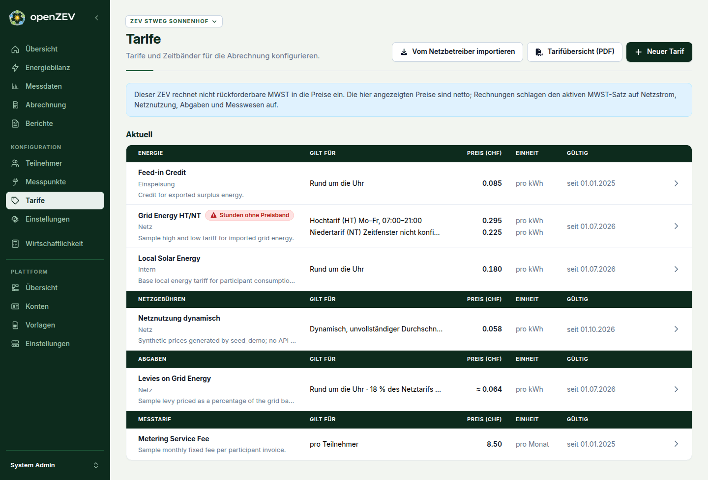
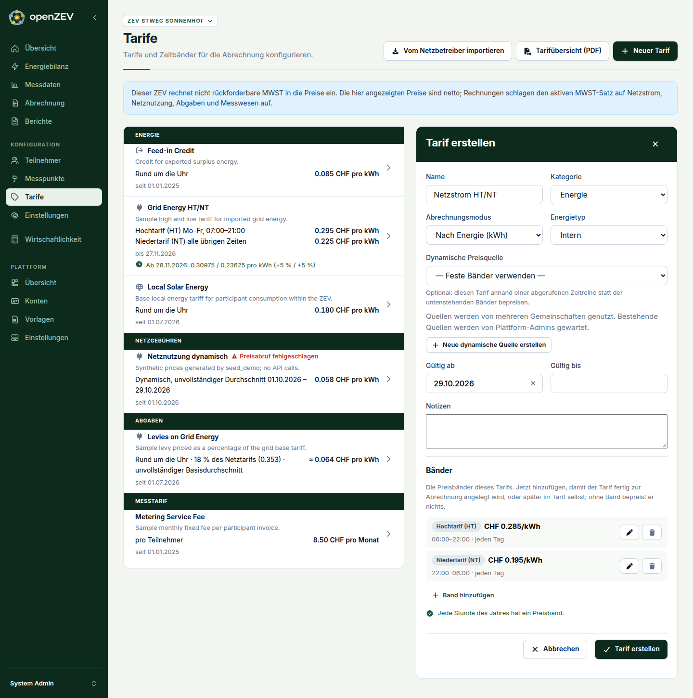
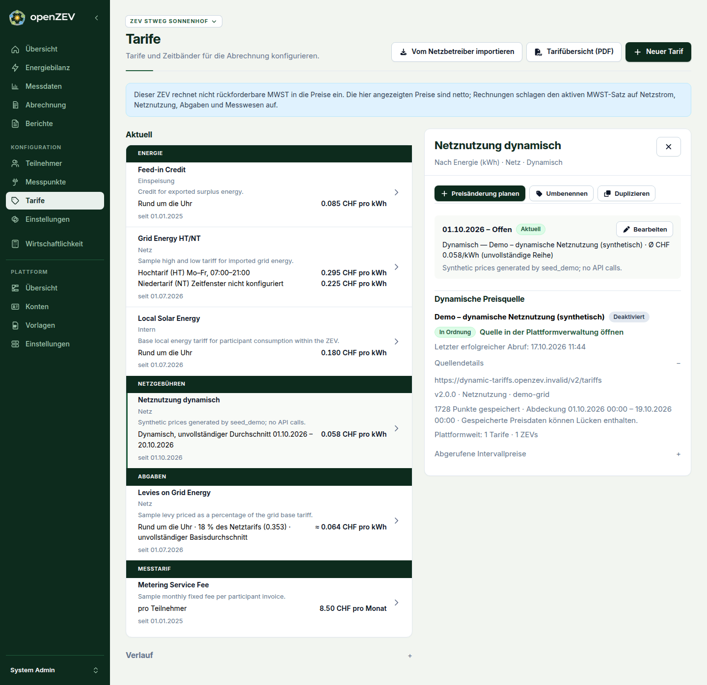
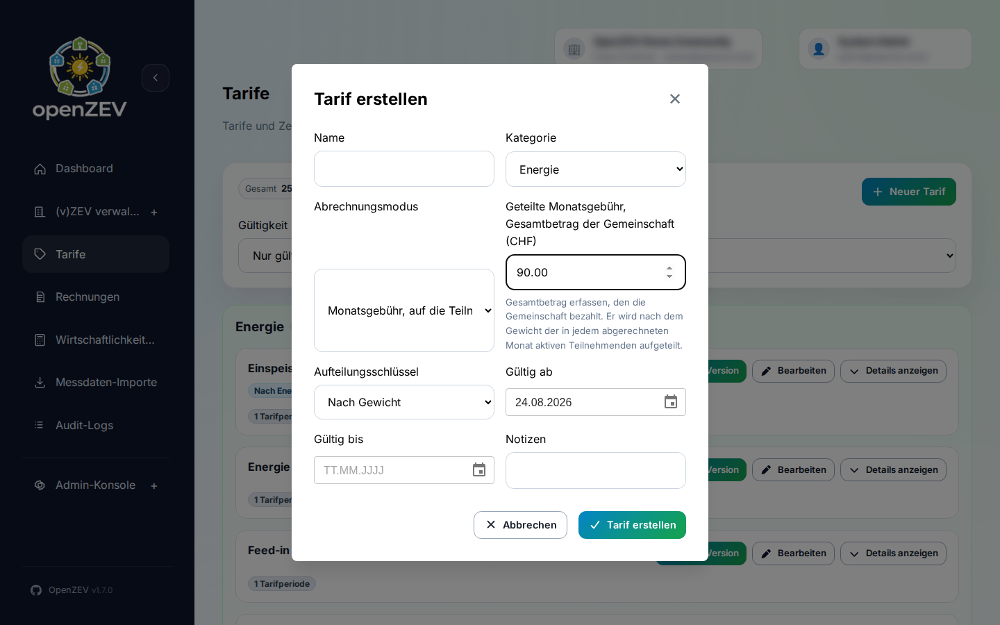
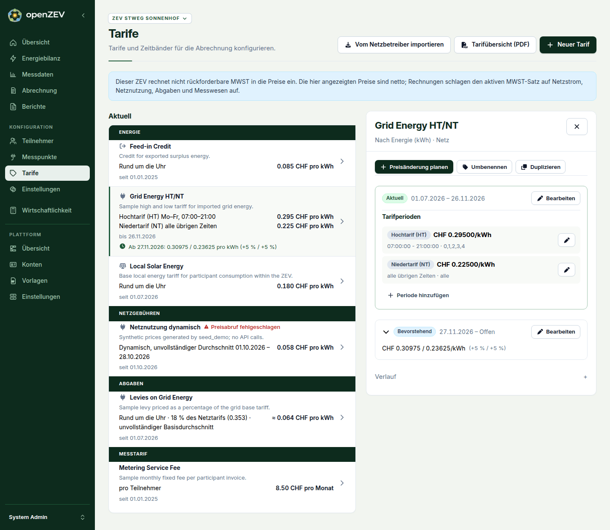
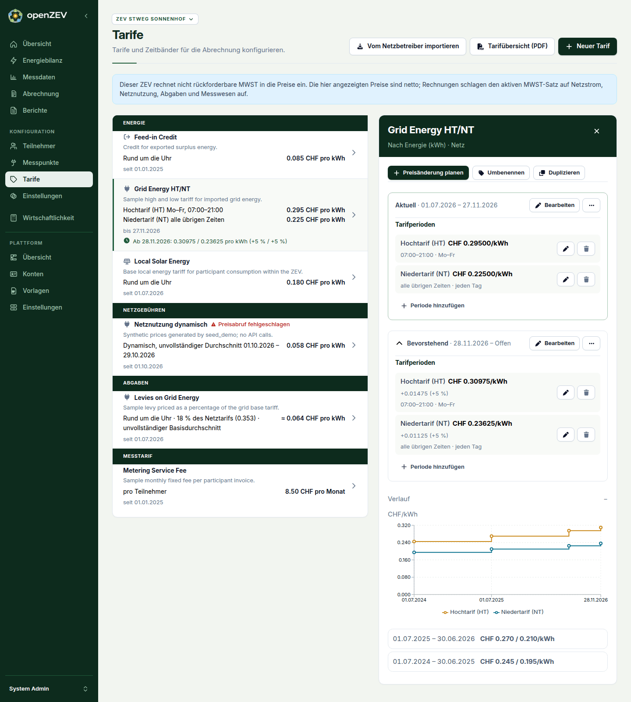
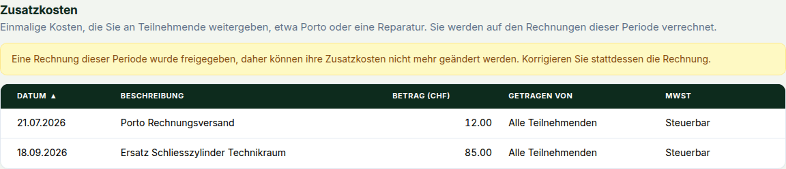

# Tariff Configuration

This guide covers setting up tariffs and pricing in OpenZEV.

## What is a Tariff?

A **tariff** is a pricing rule that defines how to charge participants for energy.

Each tariff has:
- a **Category** — `Energy`, `Grid Fees`, `Levies` or `Metering Tariff`
  (groups the lines on the invoice)
- a **Billing mode** — per kWh (*By energy*), a *Percentage of energy
  tariffs*, or a fixed fee (monthly, yearly, per metering point, or shared
  across the community)
- for per-kWh tariffs, an **Energy type** — which energy it prices:
  - **Local** — energy supplied within the community (solar)
  - **Grid** — energy imported from the external grid
  - **Feed-in** — credit for production fed back



The list is grouped by what applies when, with one row per tariff. The first
group, with no heading of its own, shows each tariff's version in force today;
**Upcoming** shows tariffs that have nothing in force yet but a version that starts later (for
example next year's grid tariff, once imported); **Ended tariffs** is folded away and
shows tariffs that have ended altogether — open it to look at or edit one that
ended by mistake. When a tariff in force has a later
version, its row says so under the validity — *From 01.01.2027: 0.315 per kWh
(+6.8 %)* when the same bands get new prices (the change in brackets, one
figure per band, in the order of the prices), *Prices and schedule change from
01.01.2027* when the bands themselves change — and clicking that line opens the
later version. **Ended tariffs** opens by itself when you follow a link to the past
version of a tariff that has ended. The headings carry no counts.

Each category is a rate card, set like the tariff overview PDF, with one row
per tariff:

- **Tariff** — the name, with a small icon for its energy type (a plug for
  grid, a solar panel for local, an arrow for feed-in; hover it for the name),
  and the first line of its note
- **Applies** — when each band applies (for example *High (HT) Mon–Fri,
  07:00–21:00*, one line per band), the percentage and the grid price used as
  its base (with “incomplete base average” when dynamic coverage is partial),
  or a fee’s allocation basis
- **Price (CHF)** and **Unit** — the displayed version’s rate, per kWh, per
  month or per year
- **Valid** — the version's validity: since when it applies (*since 01.07.2026*),
  until when (*until …*), from when it will (*starts 01.01.2027*, with the year
  in bold, and the month too when it starts this year), or when it ended

An unnamed band shows its time window once. A high, low or time band with
**no time window** (both times left empty) is the band for **all other hours**:
it prices every hour the other bands of its months and weekdays do not cover,
so "HT Mon–Fri 07:00–21:00, NT the rest" needs only the HT window. Only one
band per season and weekday can do this. Hours that no band covers, and no
such band catches, use the first band in the matching season (or the tariff's
first band if no season matches). The detail
pane and the band form say which hours are affected and what they are billed
at — for example *No band covers 00:00–07:00, 21:00–24:00; 07:00–21:00 · Sat–Sun.
Those hours are billed as High (HT) 07:00–21:00 at 0.295 CHF/kWh* — and warn
when more than one band matches the same hour (the first match applies). While
you fill in a band, the form shows whether the version's bands together cover
every hour of the year. A version of a few weeks is only checked against the
days it can contain.

A red badge next to the name means warnings: a gap between
versions, a failed price fetch, or **Hours without a band** — some hours of the
year have no band of their own and are billed at the fallback band (see below). Rows under **Ended tariffs** are grey but readable.
Click a row to open the tariff's detail pane beside the list, where **Edit**
and the other actions are; from **Upcoming** it opens on the upcoming version.
On a narrow screen (a phone, or a small window) the pane takes the whole area
and the list is hidden until you close it with **X** or the browser's **Back**
button.

The list waits for the selected community to load. If loading fails, use **Retry**;
a failed community refresh keeps the loaded scope and your open draft available.

## Creating a Tariff

**Managers** create tariffs in **Tariffs**.

Switching community or losing write access closes the open tariff pane, its form and any import dialog or delete confirmation. Save your draft before switching.

The forms for creating and changing tariffs open in the detail pane, in the
place you were just looking at the tariff, and the list stays beside them.
If you leave with unsaved input — **X**, **Cancel**, **Escape**, the browser's
**Back** button, picking another tariff or version, or reloading the page —
OpenZEV asks whether to discard it; choosing **Keep editing** leaves your input
and the selection as they were.

1. Click **New Tariff**
2. Enter details:
   - **Name** — Tariff identifier, printed on invoice lines (e.g., "Local solar")
   - **Category**, **Billing mode** and — for per-kWh tariffs — **Energy type**
     (see above)
   - **Notes** (optional)

3. Set **Validity Period**:
   - **Valid From** — Start date
   - **Valid To** — End date (leave blank for ongoing)

   > **Tip:** Leave **Valid To** blank. When the price later changes, use **New
   > version** rather than editing or creating a second tariff — see
   > [Tariff Versions](#tariff-versions).

4. Configure pricing: the fixed amount for a fee, the **initial percentage**
   for a percentage tariff (the tariff starts with one flat band at that
   percentage — you can split it into time-of-use bands afterwards, see
   [Percentage of Energy Tariff](#percentage-of-energy-tariff)), or — for a
   per-kWh tariff — a [dynamic price source](#dynamic-tariffs) if it has one

5. For a per-kWh tariff without a dynamic source, add its **Bands** right in
   the form: **Add band**, enter price, times, weekdays and months, then
   **Keep band**. You can edit or remove a band before saving, and the form
   warns about hours without a band while you build the list (see
   [Tariff Periods](#tariff-periods))

   

6. Click **Create Tariff**; the tariff and all its bands are created together,
   or — if the server rejects a band — not at all. The rejected band is marked
   in the list with the reason; fix it and save again. The new tariff opens in
   the pane

   A per-kWh tariff created without a band prices nothing until you add one
   later as a [Tariff Period](#tariff-periods); a percentage tariff starts with
   its one flat band and takes more later

## Importing Tariffs from Your Grid Operator

Swiss grid operators publish their tariffs in machine-readable form every year
(Art. 7b StromVV). Rather than transcribing next year's prices by hand, point
OpenZEV at that file and it will show you exactly what it would create.

### Running an import

1. Go to **Tariffs** and click **Import from grid operator**.
2. Paste the **Tariff document URL** — usually a `.json` file linked from your
   operator's tariff page. If you stored it under
   **Settings → Grid Connection → Tariff document URL**, it is filled in for
   you.
3. Click **Read document**. **Nothing is saved at this point.** You get a table
   of everything the document offers, with a **Status** for each row.
4. Tick what you want. **Select standard tariffs** ticks only what the operator
   itself flags as its standard product — a document can carry 35 rows when
   your community needs four, so nothing is pre-ticked wholesale.
   If the document covers more than one year — operators often publish next
   year's prices beside this year's — pick a year in the year filter to see
   only the tariffs valid in it. Changing the year resets the ticks to that
   year's standard tariffs.
5. Click **Import N tariffs**.

Leave **Remember this address for next year's tariffs** ticked and the URL is
stored on the ZEV, so next year's refresh is one click.

### One published tariff can become two

A published tariff often carries both a monthly **base price** (Grundpreis) and
a per-kWh **energy price** (Arbeitspreis). An OpenZEV tariff is billed one way
or the other, never both, so such an entry is imported as **two tariffs**:

```
Netznutzung Basis (Grundpreis)     CHF 7.00/month
Netznutzung Basis (Arbeitspreis)   CHF 0.284/kWh
```

Those suffixes are your operator's own words, and they appear on invoice lines,
so a participant comparing an invoice against the published tariff sheet sees
matching vocabulary.

### Choosing how a fee is billed

The document says a base price is CHF per month. It cannot say *who* pays it —
that depends on how your community relates to its operator. So each fee row has
a **Billed as** picker, and the choice is yours:

| Billed as | When it is right |
| --- | --- |
| **Shared monthly fee** *(default)* | The usual ZEV: the operator bills the community once for its connection, and the fee is split across participants |
| **Monthly fee** | A vZEV whose participants each hold their own contract with the operator |
| **Per metering point, monthly** | A charge levied per meter — a metering fee is the typical case |

Getting this wrong bills the same connection several times over, so the picker
never guesses on your behalf beyond the default.

### What the statuses mean

| Status | Meaning | Imported? |
| --- | --- | --- |
| **New** | Nothing like it in this community yet | Yes |
| **New version** | You already have this tariff; the document carries a later price. See [Tariff Versions](#tariff-versions) | Yes |
| **Already imported** | A version already starts on that date — you have imported this document before | No |
| **Name conflict** | A tariff of that name exists but means something else (a different category or energy type), which cannot be reconciled automatically | No |
| **Not supported** | The entry cannot be represented — the row says why | No |

Only **New** and **New version** rows can be ticked.

### Importing next year's document

Re-importing is the normal yearly workflow, and it is safe to run twice:

- Rows you have already imported come back as **Already imported** and are left
  alone. Nothing is rewritten.
- A newer price arrives as **New version**. Your existing version is closed the
  day before the new one starts, so the two never overlap and no period is
  billed twice.
- **If you renamed a tariff after importing it**, the new version still lands in
  it. OpenZEV records which published price each tariff came from, so it
  recognises your renamed tariff as the same one; the row says *Will be added
  to "your name"*, and it keeps the name you gave it.
- **The way you chose to bill a fee is remembered.** Next year's document
  proposes the default again, but the import matches what you already decided
  rather than refusing the row.

### What is not imported

These are reported in the preview rather than skipped silently — a row that
cannot be imported always says why:

- **Power / demand charges** (CHF/kW) — OpenZEV does not bill demand, and no
  demand data is metered.
- **Reactive-power charges** (CHF/kVarh).
- **Storage grid-usage refunds.**
- A **dynamic tariff with no fetchable URL**, or a component with no billable
  energy value in CHF/kWh. V2 metering components are supported when they
  publish an energy price.
- Prices in a unit that cannot be billed — an energy price not in CHF/kWh, or a
  base price not in CHF/month — and negative prices.

Where a published price is more precise than OpenZEV stores, it is rounded and
the row tells you so.

### Dynamic tariffs

Some operators no longer publish a fixed price at all — they publish a URL
that serves a new price every quarter-hour. Importing one of these creates a
tariff linked to that price source instead of to fixed bands; OpenZEV fetches
it on a schedule and bills each reading at whatever the series says for that
moment, negative prices included.

- The import preview marks a dynamic row with a **Dynamic** badge and shows
  the URL it will fetch from, instead of a list of prices — there is nothing
  to list yet.
- The document never names which *product* the source should use (an
  operator like Groupe E publishes several, at materially different prices).
  Enter the correct product name in the preview before importing. Leaving the
  visible product field blank explicitly confirms the endpoint default. V2
  product names returned by discovery are retained with the source.
- On the Tariffs page, a dynamic tariff reads **Dynamic, average** and
  the dates the average covers (the most recent 30 days) under **Applies**,
  beside its average price. These dates are not the tariff's validity, which
  the **Valid** column shows. If the source's last scheduled fetch
  failed, a red **Price fetch failed** badge appears next to the name, with
  the failure shown as a tooltip.
- You can also link a plain energy tariff to an existing dynamic source by
  hand, from the tariff's edit form — useful once a source has already been
  created by an earlier import.

Managers can choose an existing shared source or create a new source from
the energy-tariff form. Viewers can inspect linked sources and price history.
Click a dynamic tariff to see its source name, fetch status and last
successful fetch. **Source details** unfolds the endpoint, protocol, product,
stored coverage and usage. Usage counts cover the whole platform.

Below the source, the pane charts the fetched prices of the last 30 days of the
tariff's validity without opening anything. If the source has **no price for
time that has already passed**, a yellow notice says so as dates (for example
*No prices for 03.10.2026 – 05.10.2026*), the chart shades those stretches red
and breaks the line there, and **Exact missing intervals** lists the timestamps.
Invoice generation stops for a period that needs a missing price, so fetch the
prices again or wait for them to fill in. Dates in the future are not reported,
as prices may not be published yet. Change the date range above the chart to look
further back; **Fetched interval prices** opens the statistics and the full
table.
Administrators can follow **Manage source in platform admin** to its operational
row; managers create and reuse sources in the tariff form.



### Reading a dynamic tariff's price

An operator's fetched price changes every quarter-hour, so the Tariffs page
shows a **representative average** instead of a rate: `Avg CHF 0.123/kWh`,
with a tooltip explaining the reference window. It is weighted by interval
duration over the trailing 30 days within the tariff's validity — not a fixed
rate, and the contract and tariff overview say so in a footnote.

The BFE reference market price (below) publishes one price per *quarter*, and
only weeks after that quarter has ended, so its trailing 30 days would always
be empty. For that kind of source the window ends at the last fully published
day instead of at today; the reference dates beside the figure say which
period it covers.

For a percentage tariff, the base uses grid tariffs and prices at today, clamped
to the displayed version's validity. A historical percentage version therefore
uses its historical base, not the latest average of an ongoing grid tariff.

- **Partial** means the window has gaps; the average covers only what was
  fetched.
- **Price unavailable** (or **base price unavailable** on a percentage
  tariff) means nothing was fetched for the window. No substitute number is
  shown, and a percentage tariff built on it has no base either — printing a
  partial sum would understate the rate.

### Feed-in at the BFE reference market price

Many operators pay feed-in remuneration as **the greater of** a minimum price
they guarantee **or** the federal reference market price for the period. Since
1 January 2026 that is also the statutory default when nothing else is agreed
(Art. 15 EnG/EnV, reference price per Art. 15 EnFV).

Set this up in two parts:

1. **Add the reference price as a source.** In the dynamic source dialog,
   choose the kind **BFE reference market price** instead of an operator
   endpoint. Pick the series your installation reports on — **quarterly** or
   **monthly** — and the **technology** (photovoltaics for a normal rooftop
   ZEV). There is no URL to enter and nothing to discover: OpenZEV downloads
   the federal publication and stores its whole history, back to Q3 2023, the
   moment you save.
2. **Link a feed-in tariff to it and enter the minimum.** On a feed-in tariff
   with that source selected, the form shows **Minimum price (CHF/kWh)**.
   Leave it empty if your operator pays the reference price flat.

Every exported kWh is then credited at whichever is higher for that moment.
The Tariffs page shows the reference average with `min. CHF 0.080/kWh` beside
it, and the tariff overview PDF prints the rate together with the guaranteed
minimum.

- **A quarter can only be billed once BFE has published it** — roughly ten
  working days after the quarter ends. Until then the period counts as
  unpriced: readiness names the days and invoice generation refuses, rather
  than falling back to the minimum and under-crediting a producer whose
  reference price later turns out to be higher.
- The minimum is part of a tariff *version*. Renegotiating it means creating
  a new version from the date it changes, exactly like any other price.
- The figures are federal open data (`Opendata BY`). Reusing them outside
  OpenZEV — a newsletter, your own report — requires naming the source, the
  Swiss Federal Office of Energy (BFE).

### Operating a price source (administrators)

Sources live under **Platform → Overview → Dynamic prices** and are shared across
communities: two ZEVs on the same operator product fetch once, together.

- **Status** is `Healthy`, `Failed` (with the user-safe error), `Not
  fetched`, or `Disabled`. A source with an unresolved older window shows
  `Retry from <date>` — the earliest range a refresh still needs to fill.
- **Disable** a dead endpoint with the **Enable scheduled fetches** toggle
  instead of deleting it: stored prices stay as billing evidence, the
  schedule skips it, and the tariff keeps billing from history.
- Refreshes run **every 4 hours** over yesterday → two days ahead (operators
  republish during the day; day-ahead prices arrive in the afternoon). A new
  enabled source additionally fetches up to 400 days of history once, right
  after import. Disabled sources do not start automatic fetches; an explicit
  administrator fetch is still available. Re-enabling an old source fetches
  at most 14 days on a scheduled run; use backfill for older missing history.
- **404 is a failure by default.** If the operator documents that this URL
  uses 404 for an empty publication, an administrator can enable
  **empty_on_not_found** on the source in Django admin. This opt-in treats
  every 404 as empty, including a removed product; verify the URL when gaps
  persist. Rechecking capabilities preserves this setting. **410** always fails.

### Recovering a refused price series

- **BilledPriceChanged:** an operator changed a price or interval already
  retained for an invoice. The original remains stored. Check the operator's
  publication and affected invoices before correcting or cancelling invoices;
  retries cannot reconcile conflicting billing evidence.
  On a **BFE reference price** source this also stops *newly published*
  quarters from arriving, because every fetch re-reads the whole federal
  history and the conflict fails the run as a whole. Resolve the revised
  quarter — cancel or correct the affected invoice, then clear the source's
  prices — rather than waiting for the next scheduled refresh.
- **PriceIntervalConflict:** a replacement is overlapping or incomplete.
  Backfill the complete unbilled range. A complete replacement can change
  interval resolution atomically while preserving billed historical intervals.
  A partial replacement that changes a price is refused without clipping either
  boundary. A same-priced response clipped at a fetch boundary safely extends
  only the uncovered portion and keeps the existing stored boundary. If the
  endpoint no longer serves the complete interval, keep the old series and
  create a replacement source/version for future pricing.
- **PriceSeriesConflict:** the run reports one or more such refusals. Independent
  valid intervals may have been stored, but the source remains failed. Examine
  the price history and first reported conflict, then retry manually once the
  cause is resolved. Deterministic schema/product errors also need configuration
  or upstream correction; Celery does not retry them as outages.
- **Clear fetched prices** is available only when no non-cancelled invoice
  retains the source. Drafts count too. Editing or deleting a tariff cannot
  release its invoice's stored provenance. Clearing waits for any invoice
  generation transaction using the source before rechecking protection.

Republishing the same prices at another interval resolution is harmless: the
original stored rows remain as evidence. Cancelled invoices release price
protection but still retain the source itself; disable an obsolete source
instead of deleting invoice provenance. Evidence covers applicable tariff
windows conservatively, including tariffs that produced no invoice line.
Sources shared by several ZEVs serialize invoice generation and maintenance;
a long invoice transaction can delay a fetch or clear operation.

### If migration 0014 refuses existing intervals

1. Keep the previous release running with invoice generation and price-fetch
   jobs paused. Take a database backup before correcting any stored prices.
2. Use the row/source IDs in the error to inspect the affected source. For
   example, in `python manage.py shell`, read
   `DynamicPricePoint.objects.filter(source_id=source_id).order_by("valid_from").values("pk", "valid_from", "valid_to", "price_chf_per_kwh")`
   after importing the model from `tariffs.dynamic.models` and setting
   `source_id` to the reported UUID. For invalid-range errors that only name
   row IDs, first inspect those rows to find their source.
3. Compare the overlapping or inverted intervals with the original operator
   publication and retained invoices. Do not bulk-delete or clip billed
   history to make the migration pass. If the correct historical inputs
   cannot be established, retain the backup and resolve the invoice evidence
   with the operator before proceeding. There is no safe generic repair.
4. For verified unbilled data, have the administrator apply the reviewed
   correction while writers remain paused. Record the original rows and the
   correction. Retry `python manage.py migrate`; the preflight checks again
   before adding constraints. Resume jobs only after migration succeeds.

Migration 0015 can similarly refuse an exact-URL source that incorrectly claims
range-query support. Its error names the source UUID and URL. Verify that the
endpoint must be fetched verbatim, set `supports_range=False` for that source,
and retry the migration; do not change the source URL or tariff identity.

Version 2 sources need an explicit operator product name, even when the
endpoint has no published prices yet. An old blank v2 source must be disabled
and replaced with a named source. Missing product metadata in a v2 response is
a provider/schema error, distinct from the provider returning a different product.

Transfers preserve invoice totals and source provenance, but do not include
the original price points. Keep a database backup when retaining the fetched
billing inputs is required; an operator may no longer publish that history.

> **Tip:** Import prices exactly as published — they are net of VAT. If your
> community pays VAT it cannot reclaim, set the VAT treatment in
> [ZEV settings](02-zev-setup.md#vat-configuration) rather than adjusting
> tariff prices by hand; a re-import would undo that.

### Outbound URL checks

Tariff downloads must resolve to public addresses. The check cannot rule out
DNS rebinding, so also restrict outbound traffic at the network level (see the
[VSE import spec](../specs/2026-09-vse-tariff-import.md)).

## Energy Tariff Types

### Local Energy Tariff

Charges for energy consumed from the ZEV's own production.

**Pricing options:**
- **Flat rate** — Single price per kWh (e.g., CHF 0.12/kWh)
- **Time-of-use (HT/NT)** — Different rates by time-of-day
  - HT (high tariff) — Peak hours (e.g., 06:00–22:00)
  - NT (night tariff) — Off-peak (e.g., 22:00–06:00)

Example:
```
Local Energy Tariff "Summer Local"
├─ HT (06:00–22:00): CHF 0.10/kWh
├─ NT (22:00–06:00): CHF 0.05/kWh
```

### Grid Energy Tariff

Charges for energy consumed from the external grid (not covered by local production).

Usually higher than local tariff to reflect grid cost.

Example:
```
Grid Tariff "Grid 2026"
├─ HT: CHF 0.28/kWh (includes distribution)
├─ NT: CHF 0.18/kWh
```

### Feed-In Tariff

Credits for participant production fed back to community/grid.

Often lower than local tariff (encourages consumption of own production).

Example:
```
Feed-in Tariff "Solar Credit"
├─ Flat: CHF 0.08/kWh
```

### Percentage of Energy Tariff

A percentage tariff derives its price from other active tariffs rather than specifying a fixed CHF/kWh rate.

Instead of setting a price, you set a **percentage** (0–100%). During billing, OpenZEV looks up the sum of all active **grid energy tariff** rates at each timestamp and multiplies by the percentage to calculate the effective per-kWh price.

**Configuration:**
- **Billing Mode** — Select `Percentage of energy tariffs`
- **Energy Type** — `Local Energy`, `Grid Energy`, or `Feed-in` (determines which energy stream the tariff applies to)
- **Initial percentage** — The percentage value to start with (e.g., 50%), only asked when creating the tariff

Saving creates the tariff with one flat percentage band. Like a per-kWh
tariff, a percentage tariff can be split into several **time-of-use bands** —
open its entry and use **Add Period** to add a High/Low or named band, this
time entering a **percentage** instead of a CHF/kWh price. A local-energy
surcharge that is cheaper at midday and dearer in the morning and evening, for
example, can be modelled as three bands (00:00–10:00 at 90%, 10:00–16:00 at
60%, 16:00–00:00 at 90%) instead of a single flat percentage — see
[Tariff Periods](#tariff-periods) for how bands, weekdays and months combine;
everything there applies to a percentage tariff's bands exactly as it does to
a per-kWh tariff's.

Example:
```
Percentage Tariff "Local Energy 50%"
├─ Energy type: Local Energy
├─ Band: Flat, 50%
├─ Effective price: 50% of grid energy rate
│   (if Grid HT = CHF 0.28/kWh → Local = CHF 0.14/kWh)
│   (if Grid NT = CHF 0.18/kWh → Local = CHF 0.09/kWh)
```

Example with time-of-use bands:
```
Percentage Tariff "Local Solar Surcharge"
├─ Energy type: Local Energy
├─ Band "Morning": 00:00–10:00, 90%
├─ Band "Midday":  10:00–16:00, 60%
├─ Band "Evening": 16:00–00:00, 90%
```

> **Cover the whole day.** The bands should together cover all 24 hours. Give
> every band a time window, or leave both times empty on one band to make it
> the band for **all other hours** ("the rest of the day"). Without such a
> band, an hour no band covers is billed at the tariff's first band instead,
> which is usually not what you meant.

This is useful when you want to set local energy prices as a fraction of the grid energy rate, so that price changes to the grid tariff are automatically reflected.

### Fixed Fee Tariff

Flat monthly or yearly charges (not energy-dependent).

**Charge types:**
- **Monthly fee** — CHF X per month, charged to *each* participant
- **Yearly fee** — CHF X per year, charged to each participant (paid monthly as CHF X/12)
- **Per-metering-point fee** — CHF Y per active meter per month. A
  [community metering point](04-metering-points.md#shared-common-area-metering-points)
  is charged once and split across the community by allocation weight, instead
  of being charged to its holder.
- **Per-metering-point yearly fee** — CHF Y per active meter per year, billed in
  monthly instalments (CHF Y/12). Split the same way as the monthly variant.
- **Shared monthly fee** — CHF X per month for the *whole community*, divided between the participants
- **Shared yearly fee** — CHF X per year for the whole community, divided and paid monthly

Example:
```
Fixed Fees 2026
├─ Community admin fee: CHF 50/month     (each participant pays 50)
├─ Meter maintenance:   CHF 5 per meter/month
├─ Caretaker contract:  CHF 90/month shared  (3 participants → 30 each)
```

### Shared Fees

Use a shared fee for a cost the community carries **jointly** — a caretaker
contract, an insurance premium, the ZEV's own administration — rather than one
attributable to a participant's consumption or meters.

> **The price you enter means something different here.** For every other fixed
> fee, the amount is what *one participant* pays. For a shared fee it is what
> the **whole community** pays. Entering CHF 20 intending "per person" will bill
> the community CHF 20 in total, not CHF 20 each.

#### How a shared fee is split

- The amount is divided between the participants **active in each billed month**.
- The division is recalculated every month, so somebody joining in February does
  not change what January cost.
- Each participant is charged only for the months they were actually a member.

**Split key.** When you pick one of the two shared billing modes, a **Split
key** selector appears with two options:

| Split key | Divides the amount by |
| --- | --- |
| **Equally between participants** (default) | Headcount — everybody pays the same share |
| **By allocation weight** | Each participant's [allocation weight](03-participant-management.md#allocation-weight) |

`Equally` is the original behaviour and stays the default, so existing shared
fees are untouched. Choose *By allocation weight* when the community has agreed
that a joint cost should follow the same key as common-area energy — for
example, billing the caretaker contract by floor area rather than per head.

With every participant left at the default weight of `1`, both keys produce
exactly the same amounts.



> **Switching the key changes what people pay.** The selector only appears for
> the two shared modes, and the change is recorded in the audit log along with
> the rest of the tariff edit. Regenerate draft invoices to apply it.

The split key applies **only** to the two shared fee modes. Per-metering-point
fees on a [community metering point](04-metering-points.md#shared-common-area-metering-points)
always divide by allocation weight — there is nothing to configure, because the
cost belongs to a shared *meter* rather than to the community as a whole.

For a worked example of how a shared fee splits as members join and leave, and
how rounding works, see
[How Energy Allocation and Billing Works](08-billing-allocation-explained.md#shared-fees-and-changing-membership).

**A note on the issuer:** the issuer is counted like anyone else, provided
they have a participant record in the ZEV. An issuer that is not a participant
(a property management company, say) is not counted and not charged.

**Credits:** enter a negative amount to distribute a community-wide *rebate*
across the participants. It appears on invoices as a credit line.

## Tariff Periods

**Tariff periods** hold a per-kWh tariff's prices. There are no default
periods: a new per-kWh tariff has none until you add one. A [percentage
tariff](#percentage-of-energy-tariff) uses the same periods and the same
**Add Period** form, entering a **percentage** instead of a **CHF/kWh**
price — everything below about period types, time windows, weekdays and
months applies to it unchanged. Each period has a type:

| Period type | Use for |
| --- | --- |
| **Flat** | One price around the clock |
| **High (HT)** / **Low (NT)** | The usual two-rate tariff, e.g. HT 06:00–22:00 and NT for the rest |
| **Time band** | Any further price — a weekend rate, a winter price — named with its own **Band name** |

To add one:

1. Click the tariff to open its detail pane
2. Click **Add Period** under the version's bands
3. Enter:
   - **Period type** (see above) and, for a time band, a **Band name**
   - **Time from** / **Time to** — HH:MM (24-hour format), in Swiss time
     (CET/CEST): 06:00 means 06:00 on the clock in Switzerland in winter and
     summer alike, whatever format the readings were imported in
   - **Weekdays** and **Months** the period applies to (all selected means
     every day / all year)
   - **CHF/kWh** (per-kWh tariff), or **Percentage** (percentage tariff)
4. Click **Save Tariff Period**

> **Crossing midnight:** If the end time is not after the start time, the
> period wraps past midnight: 22:00–06:00 covers the night, and an end time of
> 00:00 means the end of the day (16:00–00:00 is the evening). The weekdays
> you select refer to the day of each hour itself, so a Monday–Friday
> 22:00–06:00 period covers Friday night up to midnight and the early hours of
> Monday to Friday, but not Saturday morning.

## Multi-Tariff Configuration

Most ZEVs use multiple tariffs simultaneously:

| Tariff | Purpose | Typical Price |
| --- | --- | --- |
| Local Energy (HT) | Community supply, daytime | CHF 0.10/kWh |
| Local Energy (NT) | Community supply, night | CHF 0.05/kWh |
| Grid Energy (HT) | External grid, daytime | CHF 0.28/kWh |
| Grid Energy (NT) | External grid, night | CHF 0.18/kWh |
| Feed-in | Participant solar credits | CHF 0.08/kWh |
| Fixed Fee | Monthly admin cost, per participant | CHF 50/month |
| Shared Fee | Joint community cost, divided between participants | CHF 90/month total |

During billing, OpenZEV automatically selects the right tariff for each timestamp and energy type.

## Tariff Versions

Prices change — usually every year. Rather than creating a new tariff each time,
add a **version** to the existing one.

All versions of a tariff share its **name**. That is what makes them versions:
the name identifies the tariff, and the validity windows say which version
applied when.

```
Local Energy                                    ← one tariff, three versions
├─ 2025-01-01 → 2025-12-31   0.10 CHF/kWh
├─ 2026-01-01 → 2026-12-31   0.11 CHF/kWh
└─ 2027-01-01 → (open)       0.12 CHF/kWh       ← active
```

### Adding a New Version

1. Click the tariff to open its detail pane, then click **Schedule price change**
2. Enter the date the new prices take effect (defaults to today)
3. Adjust the prices (pre-filled from the current version); the form says what
   will apply from that date
4. Click **Schedule price change**

OpenZEV **closes the previous version automatically** on the day before, so the
timeline stays continuous. You never set an end date by hand — the form names
the closing date it will use as you pick the start date.

> **Why this matters:** if a day falls between two versions, OpenZEV has no price
> for it. The energy still appears on the invoice but is **charged at nothing** —
> a whole month can be given away without any warning. Letting OpenZEV compute
> the end date removes the off-by-one that causes this. Any series that already
> has a gap is flagged on the tariff entry.

You can also insert a version *between* two existing ones; OpenZEV bounds it on
both sides.

### Comparing Versions

The Tariffs page shows **one entry per tariff**, using the version selected by
the current list view rather than listing every version separately. Click it
to open the detail pane beside the list with
everything else.

At the top of the pane, **Schedule price change**, **Rename** and **Duplicate**
act on the whole tariff. Under them, each version in force or scheduled has its
own card, the one in force first:

- The card opens with its status — **Current** or **Upcoming** — and its
  validity window, so you can't mistake a future version for the current rate,
  and has its own **Edit** button. Below come the dynamic source if there is
  one, or the price bands with a pencil on each and **Add Period** under them.
  The notes appear on a card only when they differ from the ones the list row
  already shows.
- A **scheduled** version starts as a single line — its prices, what they change
  against the version before (for example *−1.7 % / −2.2 %*) and a red
  **Hours without a band** badge if it has uncovered hours. Click it to open the
  card and edit its bands. It is open from the start when you came to it from
  the list's *From 01.01.2027: …* line.
- Next to each band price, a scheduled card shows how that price moves against
  the version it replaces (*−0.005 (−1.7 %)*); a fixed fee shows its amount.



**History** is folded away under the cards, with the number of ended versions.
Open it for the price chart and the list of past versions with their window and
price; click one to show its card — marked **Ended** — underneath. A tariff
without ended versions has no history. Switching versions in the pane does not
change the version shown in the list.

To delete a version, open the **⋮** menu beside **Edit** on its card and choose
**Delete this version**; to delete a band, click the trash icon beside its
pencil. Both ask for confirmation first, and the confirmation repeats that
existing invoices are not recalculated. Correcting a superseded version's end
date is a normal follow-up to adding a new one, so **Edit** is on every card.

The pane stays open across a page reload or a shared link — the URL records
which tariff and version you're looking at. **X**, **Escape** and the browser's
**Back** button all return to the list.



### Price History

Once a tariff has **more than one version**, its detail pane also charts how
its price moved over time; open **History** to see the chart.

- The line is **stepped**, not sloped — a price holds for its whole window and
  then jumps. A sloped line would suggest it drifted between two Januaries.
- HT and NT are **separate lines**, so you can see the spread widen or narrow.
- **Uncovered stretches are shaded red** and the line breaks: nothing was billed
  there. This is the same problem the list's gap badge reports, shown on a
  timeline.
- For a **percentage tariff** the chart shows one line per band, each the
  *effective* price it worked out to, derived from the grid tariffs in force
  at each point — so it moves when those move, even in months this tariff
  itself did not change. A note under the title says so. A tariff with a
  single flat band still shows one line, exactly as before bands existed.

### Renaming

Renaming is done for the **whole tariff**, not per version — the name is what
holds the versions together, so renaming just one would split it into two
unrelated tariffs. **Rename** sits at the top of the detail pane, and tells
you how many versions it will affect.

### Duplicating

Use **Duplicate** (also at the top of the detail pane) to create a *different*
tariff starting from an existing one's numbers. It asks for a new name and leaves
the original untouched. (Use **Schedule price change** instead when the prices of the
*same* tariff have changed.)

### Which Version Gets Billed

OpenZEV picks the version that was valid **on each individual reading's
timestamp** — not the one valid at the end of the invoice period. So an invoice
covering a price change is priced correctly on both sides of it: a January–March
invoice uses the old price for January and the new one from February.

## Tariff Validation

When saving a tariff, OpenZEV checks:

| Check | Requirement |
| --- | --- |
| **Valid From ≤ Valid To** | Validity period must be in order |
| **No overlapping windows for the same name** | Two tariffs *called the same thing* can't both be valid on the same date — see below |
| **Versions agree on identity** | All versions of a name share one category, billing mode and energy type |
| **Price format** | Numeric, up to 5 decimals (e.g., `0.12345` CHF/kWh) |
| **Mandatory fields** | Name, type, validity period, prices |

If validation fails, you'll see a clear error message. Fix and retry.

### Several Tariffs at Once Is Normal

You can have **as many tariffs applying simultaneously as you need**, including
in the same category, with the same billing mode and the same energy type. This
is the usual shape of a Swiss tariff sheet:

```
Grid Fees
├─ Netznutzung Arbeit         0.09000 CHF/kWh
└─ Systemdienstleistung SDL   0.00750 CHF/kWh

Levies
├─ Netzzuschlag               0.02300 CHF/kWh
└─ Kantonale Abgabe           0.00500 CHF/kWh
```

All four apply at once, and each becomes its own line on the invoice, so
participants see what they are paying for rather than one merged figure.

The **only** thing OpenZEV blocks is two tariffs with the **same name** whose
validity windows overlap — because same name means same tariff, so an overlap
means two prices claim the same day:

```
✗ Local Energy   2026-01-01 → (open)      ← old version, never closed
  Local Energy   2026-04-01 → (open)      ← new version
    Both apply. Every participant is billed twice.

✓ Local Energy   2026-01-01 → 2026-03-31  ← closed automatically
  Local Energy   2026-04-01 → (open)
```

Use **Schedule price change** and you never hit this: OpenZEV closes the old window for
you. You only see this error when editing validity dates by hand. If two tariffs
really are meant to apply together, give them different names — which you would
want anyway, since the name is what appears on the invoice line.

Because a shared name makes two tariffs versions of each other, they must also
**agree on what the tariff is** — same category, same billing mode, same energy
type. OpenZEV rejects a version that disagrees and tells you which value the
others use. If you meant a genuinely different tariff, give it a different name.

## Copying Tariffs to Another Community

The tariff-only JSON export has been replaced by a whole-ZEV transfer. To move a
tariff structure to another instance, export the ZEV with **only the Tariffs
section** selected and import it there — the result is a new ZEV carrying just
the pricing. See [ZEV Export and Import](17-zev-transfer.md).

## Editing and Deactivating Tariffs

### Updating a Tariff

Edit **future** tariffs freely:

1. Click the tariff to open its detail pane
2. Click **Edit** on the version's card
3. Change prices, periods, validity dates
4. Click **Save**

Changes apply to **new invoices only**. Past invoices keep original tariffs.

**Edit** works on one **version**: the form is titled *Correct this version*,
with the tariff's name and the version's validity window under the title, and
says again that existing invoices are not recalculated. The fields that
identify the tariff — name, category, billing mode, energy type — are not in the
form at all: they are shared by every version, so changing them on one alone
would break the series. Use **Rename** for the name; for a different category,
billing mode or energy type, create a separate tariff. The cursor starts in the
first field, and **Notes** is a multi-line box.

> **Prices changed from a certain date?** Use **Schedule price change** instead of editing.
> Editing rewrites what the *current* version has always charged; a new version
> records the change, keeps the old prices on the record, and lets invoices
> spanning the switch bill each part correctly. See
> [Tariff Versions](#tariff-versions).

### Deactivating a Tariff

Set **Valid To** to exclude from future invoices:

1. Click the tariff to open its detail pane
2. Click **Edit** on the version's card
3. Set **Valid To** to today or last usage date
4. Click **Save**

> **Important:** Never delete a tariff—always set Valid To instead. This preserves invoice audit trail.

This applies to **Delete this version** too. Deleting a version
removes the prices that applied in its window, which leaves a gap: energy in
those days is then billed at nothing. Reserve it for a version created by
mistake — one you have not billed against.

## Tariff Application During Billing

When OpenZEV generates an invoice:

1. **For each timestamp in billing period:**
   - Identify energy type (local vs. grid)
   - Find applicable tariff by validity date
   - Find applicable period (HT vs. NT) by timestamp
   - Multiply energy × price

2. **Fixed fees:**
   - Sum all applicable monthly fees by calendar month in period
   - Apply yearly fees as monthly installments (price ÷ 12)
   - Group by metering point type if per-point fees

3. **Final invoice:**
   - Sum all line items
   - Apply VAT if configured
   - Create PDF invoice

> **See also:** [How Energy Allocation Works](08-billing-allocation-explained.md) for detailed billing logic.

## Printing a Tariff Overview

Click **Tariff overview (PDF)** on the Tariffs page toolbar and choose
**Valid tariffs** to download every tariff in force today, grouped by category (Energy, Grid Fees, Levies,
Metering) — the same grouping and order as an invoice's line items.

- Each price band is listed and named on its own line, using the exact same
  wording as the participation contract (HT/NT, a seasonal band's month
  range, or a plain band's time window) — the two documents describe a
  tariff the same way.
- A **percentage-of-energy tariff** prints one row per band — a tariff with
  a single flat band prints one formula (e.g. `18.00 % × 29.50 Rp./kWh`), and
  a tariff with several time-of-use bands prints one row per band, each
  named the same way a per-kWh band is. Each is computed from the same grid
  tariffs the participation contract uses. If the grid tariff it is based on
  has more than one price band, a footnote explains that the figure shown is
  the tariff's base rate, not what any single reading is actually billed at.
- A **shared fee** states how it is split (equally, or by weight) — the
  figure printed is what the whole community pays, not one participant's
  share.
- The document states the ZEV's VAT treatment. Under **VAT inclusive**, an
  explicit note says the prices shown are net and that VAT is added on the
  invoice — the number on this document is deliberately not the number a
  participant is billed.
- **All versions, including superseded and future ones** adds the tariff
  versions not in force today, shown greyed out with their full validity span
  instead of "from …".

There is no date picker (yet) — the overview always reflects today. Only the
community's managers and viewers, and admins, can download it; there is nothing on this document a
participant does not already see broken out on their own participation
contract or invoice.

## One-off Charges

A tariff describes a price that recurs. A cost that happens **once** — postage
for the invoice run, a repair, a one-time fee — is not a tariff. Record it as a
**charge** in the **Charges** section under the period's invoices
(**Billing → Invoices**, pick the period) and OpenZEV puts it on the right
invoices as its own line, under **Other charges**.

Because the charge lives apart from the invoice, it **survives regeneration**:
regenerate a draft as often as you like and the line comes back.



### Adding a charge

Choose **Add charge** and fill in:

| Field | Meaning |
| --- | --- |
| **Description** | What appears on the invoice line, e.g. *Postage, March invoice run* |
| **Total amount (CHF)** | The whole cost, greater than zero |
| **Date** | Decides who pays (see below); limited to the period you are working in |
| **Who pays** | *All participants*, or *Selected participants* |
| **Split** | *Equally* or *By weight* (the participants' [allocation weight](03-participant-management.md#allocation-weight)); only shown when more than one person pays |
| **VAT** | *Taxable* or *Pass-through* (see below) |

A live **Who pays what** table under the form shows each participant's share
before you save. It uses the same calculation the invoice does.

### The date decides

A charge is billed on the invoice whose period contains its **date**, and the
people who pay are the members **on that date**. Somebody who joined after the
date is not charged; somebody who left before it is not either. Both a single
invoice and a batch run therefore agree on who pays what.

### Rounding

Each share is rounded to the centime on its own, exactly as for
[shared fees](#shared-fees). CHF 10.00 divided between three people bills
CHF 3.33 each, CHF 9.99 in total. The form tells you when rounding leaves part
of the amount unrecovered (or bills slightly more than the total). A share that
rounds to zero is left off.

### VAT

| Treatment | Use it for | Effect on a VAT-registered community |
| --- | --- | --- |
| **Taxable** (default) | Your own service or cost | Part of the VAT base: VAT is added on top |
| **Pass-through** | An expense you pay in the participant's name and pass on at cost | No VAT is added |

> **Check with your tax adviser** that a cost really qualifies as a
> pass-through before you use it. OpenZEV applies the choice you make; it does
> not judge it.

If the community is not VAT-registered, or folds VAT into its prices, the
charge is billed as entered.

### Changing and deleting

Edit or delete a charge from the row's actions menu. Draft invoices that
already carry it keep the old line until you regenerate them — the
[Overview](09-invoice-management.md#billing-work-by-period-overview) lists
those drafts under the **Charges** step so you don't forget.

### The period locks with the first approval

As soon as **any** invoice of the period is approved (or sent or paid; a
cancelled one does not count), the period's charges are **frozen**: you cannot
add, edit or delete any of them, and the **Add charge** button is replaced by a
warning. This holds for the whole community, not only the people who pay the
charge, so the period is always billed from one set of charges. To change
something afterwards, correct the invoice (see
[Correcting a paid invoice](09-invoice-management.md#correcting-a-paid-invoice-with-a-credit-note)),
or record the cost in a later period.

Add every charge **before** you approve the first invoice of the period, then
regenerate the drafts.

Charges are part of a [ZEV export archive](17-zev-transfer.md) and of backups.

## Tariff Tips

**Use consistent naming:** Helps operators find right tariff.
- ❌ Bad: `Tariff1`, `FeeX`, `new_rate`
- ✓ Good: `Local Energy HT 2026-Q2`, `Grid Energy 2026`, `Fixed Fees Monthly`

**Plan ahead:** Create seasonal tariffs before the season starts.

**Test with draft invoices:** Generate test invoices before finalizing.

**Review after each quarter:** Check if tariffs align with actual ZEV costs.

## Next Steps

- **Check data quality:** [Metering Analysis](06-metering-analysis.md)
- **Understand allocation:** [How Energy Allocation Works](08-billing-allocation-explained.md)
- **Bill a one-off cost:** [One-off Charges](#one-off-charges)
- **Generate invoices:** [Invoice Management](09-invoice-management.md)
